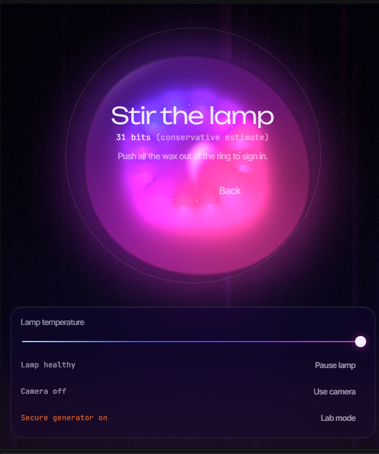
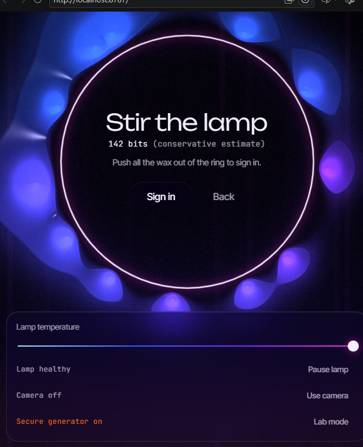
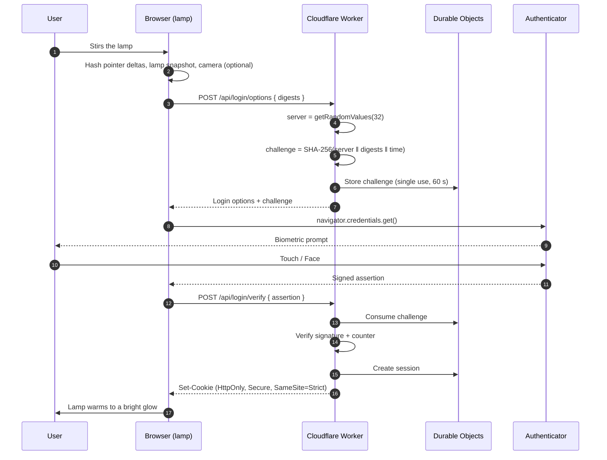
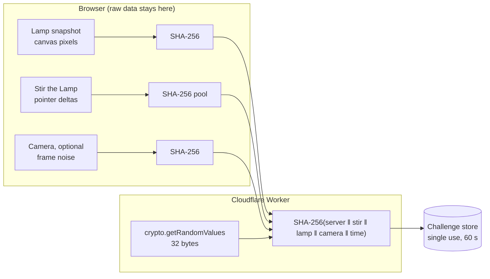
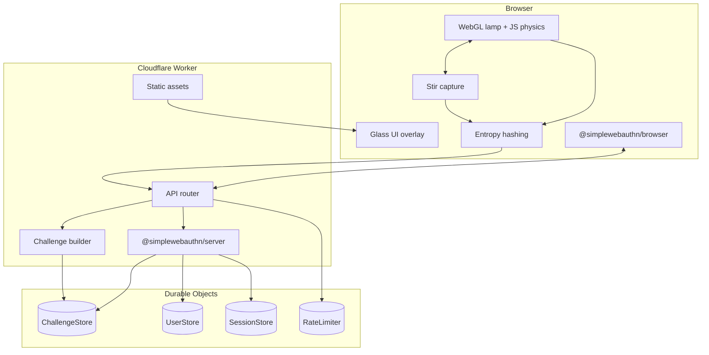

<div align="center">

# LavaAuth

**Passwordless login where the lava lamp *is* the interface.**

Passkeys on Cloudflare Workers · an entropy pool you can stir with your finger · a lamp you can freeze to prove it never mattered.

[Live demo](https://lavaauth.yohance611.workers.dev) · [60-second video](#demo) · [How it works](#how-it-works) · [Security model](#security-model)

</div>

---

## Table of contents

1. [What is LavaAuth?](#what-is-lavaauth)
2. [Features](#features)
3. [Demo](#demo)
4. [The experience, screen by screen](#the-experience-screen-by-screen)
5. [How it works](#how-it-works)
6. [Stir the Lamp: pointer entropy](#stir-the-lamp-pointer-entropy)
7. [The entropy pipeline](#the-entropy-pipeline)
8. [Security model](#security-model)
9. [Why a simulated lamp isn't random](#why-a-simulated-lamp-isnt-random)
10. [Threat model](#threat-model)
11. [Architecture](#architecture)
12. [Tech stack](#tech-stack)
13. [Project structure](#project-structure)
14. [Getting started](#getting-started)
15. [Configuration](#configuration)
16. [API reference](#api-reference)
17. [Durable Objects](#durable-objects)
18. [The lamp engine](#the-lamp-engine)
19. [Design system](#design-system)
20. [Accessibility](#accessibility)
21. [Performance](#performance)
22. [Browser and device support](#browser-and-device-support)
23. [Testing](#testing)
24. [Deployment](#deployment)
25. [Demo script](#demo-script)
26. [Build phases](#build-phases)
27. [Working on this repo with Claude Code](#working-on-this-repo-with-claude-code)
28. [Quality bar](#quality-bar)
29. [Troubleshooting](#troubleshooting)
30. [FAQ](#faq)
31. [Roadmap](#roadmap)
32. [Contributing](#contributing)
33. [License](#license)
34. [Acknowledgements](#acknowledgements)

---

## What is LavaAuth?

LavaAuth is a passwordless authentication system with an unusual front end: the entire screen is a living, glowing lava lamp. Soft blobs of magenta, violet, electric blue and ember red melt into each other on a near-black background, and every security event shows up as something the wax does.

- Signing up gathers the wax into a glowing portal.
- Logging in asks you to **stir the lamp**: the wax fills a glowing ring, and you drag your mouse or finger to stir it all back out. That motion is hashed into the entropy pool, and **Sign in** appears once the ring is clear.
- Failures fizzle. Successes glow.
- A temperature dial lets you **freeze the lamp** completely, and login still works securely, because the real randomness was never coming from the lamp.

The project is a playful nod to Cloudflare's famous wall of lava lamps, built around a serious point: decorative entropy can *add* to security, but a well-designed system must never *depend* on it.

---

## Features

**Authentication**
- Passkey (WebAuthn) sign-up and login: Face ID, Touch ID, Windows Hello, Android biometrics, or a hardware security key
- No passwords, no emails required to log in, nothing to phish
- Single-use, short-lived challenges stored in Durable Objects
- Rate limiting per IP, and per username for sign-up
- Revocable sessions in `HttpOnly`, `Secure`, `SameSite=Strict` cookies

**Entropy**
- **Stir the Lamp:** pointer and touch motion captured with coalesced events, hashed in the browser
- Lamp snapshots: canvas pixels hashed with SHA-256
- Optional camera noise: webcam frames hashed locally, never uploaded
- Server-side mixing with `crypto.getRandomValues()` on every challenge
- Health checks that reject repeated snapshots, robotic stirring and covered cameras

**Experience**
- WebGL metaball lamp with temperature-driven physics, a soft glow and film grain
- Frosted-glass UI over the wax
- Clear the ring: stir the wax out of the ring to reveal Sign in
- Lab mode: a live, animated view of the entropy pipeline, with NIST monobit and runs tests
- Freeze the Lamp: the demo's showpiece
- Reduced-motion support, and every action except clearing the ring works by keyboard
- Planned: a real two-pass bloom, glass that refracts the wax, and optional ambient sound

---

## Demo

Demo video coming soon.

<p align="center">
  
  
</p>

*Signing in. Left: the wax gathers inside the ring. Right: stirred out with human-like motion, the ring is clear and **Sign in** appears.*

The 60-second video will show: landing → clear the ring → passkey login → Lab mode → freeze the lamp → log in again with the lamp frozen.

---

## The experience, screen by screen

| # | Screen | What the wax does |
| --- | --- | --- |
| 1 | **Landing** | The lamp drifts slowly. Your cursor is a gentle heat source: nearby blobs warm, turn magenta and rise toward it. One headline, one tagline, one frosted "Enter" button breathing on a 4-second cycle. |
| 2 | **Sign up** | Blobs gather into a glowing ring in the centre while your device asks for a biometric. On success, the ring bursts and the wax rises in a slow celebratory wave. |
| 3 | **Log in: Stir the Lamp** | "Stir the lamp." The wax gathers inside the luminous ring. Stir it all back out: blobs scatter from your pointer and swirl in its wake, but only human-like motion moves them, and wax you push out stays out. The ring's arc fills as the wax leaves. When the ring is clear, **Sign in** fades in; press it, the wax drifts back, the passkey prompt appears, and success warms the whole lamp. |
| 4 | **Lab mode** | Split screen: lamp on one side, the entropy pipeline on the other as glowing flow lines, with live meters for snapshots accepted/rejected, stir entropy, lamp health, camera health and randomness tests. |
| 5 | **Freeze the Lamp** | Turn the dial to zero: the wax stops, colours cool to ice blue, frost creeps across the glass, lamp health turns red. *"Lamp offline. Secure generator holding the line."* Login still works. |
| 6 | **Failure states** | Camera covered: the lamp dims. Repeated snapshot: a droplet falls and fizzles instead of merging. Robotic stirring: the ring stalls and flickers, *"Too regular, keep stirring."* |

---

## How it works

At a high level, every login looks like this:

1. **The browser collects entropy** from the user stirring the lamp, from a lamp snapshot, and (optionally) from the camera. Each source is hashed locally with SHA-256.
2. **The browser sends only the 32-byte digests** to the Worker when it requests login options.
3. **The Worker generates 32 bytes of real randomness** with `crypto.getRandomValues()`.
4. **The Worker builds the challenge** by hashing its own random bytes together with the client digests and a timestamp.
5. **The challenge is stored single-use** in a Durable Object with a 60-second expiry.
6. **The browser asks the authenticator to sign the challenge** (Face ID, fingerprint, security key).
7. **The Worker verifies the signature**, consumes the challenge so it can never be reused, and issues a revocable session.



---

## Stir the Lamp: pointer entropy

Stirring is the centrepiece of the login. While you clear the ring (typically 3–5 seconds), it collects your motion, credits it conservatively, and mixes its hash into the challenge.

### What the wax does

| Behaviour | Rule |
| --- | --- |
| Repulsion | Each blob is pushed away from the pointer with falloff `1 / (1 + (d / r)²)`, where `r ≈ 18%` of the short screen edge |
| Swirl | A tangential force proportional to pointer velocity, so blobs curl into the wake like stirred liquid |
| Heat | Stirred blobs gain temperature, shift toward magenta, and rise once the pointer leaves |
| Splitting | Strokes above a speed threshold split a large blob in two, conserving area |
| Clear the ring | Wax inside the ring is held still and moves only while your motion passes the health checks; stirred wax is flung outward, and wax you push out stays out |
| Return | When you press Sign in, a soft attractor pulls everything back to centre over about 2 seconds |

### What gets captured

- `pointermove` events, expanded with `getCoalescedEvents()` so every hardware sample is used, not just one per frame
- Per event: `dx`, `dy`, the time delta from `performance.now()`, plus `pressure`, `tiltX` and `tiltY` when the device reports them
- **Not credited:** absolute positions (easy to guess) and any event where `isTrusted` is `false` (scripted input)

### Processing

```ts
// src/client/stir/pool.ts (simplified)
const BATCH = 32;
let pool = new Uint8Array(32); // running digest
let buffer: number[] = [];

export async function addEvent(e: StirSample) {
  buffer.push(e.dx, e.dy, e.dt, e.pressure ?? 0, e.tiltX ?? 0, e.tiltY ?? 0);
  if (buffer.length >= BATCH * 6) await flush();
}

async function flush() {
  const data = new Float64Array(buffer);
  const joined = new Uint8Array(pool.length + data.byteLength);
  joined.set(pool, 0);
  joined.set(new Uint8Array(data.buffer), pool.length);
  pool = new Uint8Array(await crypto.subtle.digest("SHA-256", joined));
  buffer = [];
}

export const digest = () => pool; // only this ever leaves the device
```

### Crediting and health checks

| Rule | Value |
| --- | --- |
| Max credit per accepted event | 1 bit |
| Max credit per second | 60 bits |
| What unlocks Sign in | A clear ring, not a bit count; the bits are shown as a conservative estimate |
| Rejected (0 bits) | No movement · repeated time delta · near-zero direction change across the last 8 samples (straight lines, constant velocity) · untrusted events |

> **Honesty note:** browsers deliberately coarsen `performance.now()`, and human motion is partly predictable. These numbers are a **conservative UX meter**, not a formal entropy measurement. Lab mode says so on screen.

### No skip, by design

- **Clear the ring:** when you sign in, the wax gathers inside the ring. Stir it all back out; only human-like motion moves it, and wax you push out stays out. Then **Sign in** appears.
- **Required:** there is no skip and no keyboard alternative. It's a ritual, not a security check: your passkey's fingerprint, face or PIN is what proves a person is there. See [Accessibility](#accessibility) for who this excludes.

---

## The entropy pipeline



### Sources

| Source | Where it runs | What is sent | Health check |
| --- | --- | --- | --- |
| Stir the Lamp | Browser | 32-byte digest | Rejects robotic or repeated motion |
| Lamp snapshot | Browser | 32-byte digest | Rejects a snapshot identical to any of the last 64 |
| Camera (optional) | Browser | 32-byte digest | Flags low variance (covered lens) or repeated frames |
| Secure generator | Worker | Never leaves the server | Always on, cannot be disabled |

### Mixing

```ts
// src/worker/entropy/mix.ts (simplified: the real one also adds a one-byte
// tag per source, so an absent digest is distinct from any present one)
export async function buildChallenge(client: ClientDigests): Promise<Uint8Array> {
  const server = crypto.getRandomValues(new Uint8Array(32)); // always present
  const time = new TextEncoder().encode(Date.now().toString());
  const parts = [server, client.stir, client.lamp, client.camera, time]
    .filter((p): p is Uint8Array => !!p);
  return new Uint8Array(await crypto.subtle.digest("SHA-256", concat(parts)));
}
```

Client digests are treated as **untrusted input**. They are length-checked (exactly 32 bytes or absent) and never validated for "randomness" on the server, because it doesn't matter: the server's 32 random bytes are always part of the hash.

---

## Security model

The core rule:

> **Decorative entropy can add to security. It can never replace or weaken the secure generator.**

What this means in practice:

- **The server always contributes 32 bytes from `crypto.getRandomValues()`.** If every client source is missing, frozen, or attacker-controlled, the challenge is exactly as strong as one built from the secure generator alone.
- **Challenges are single-use.** The Durable Object deletes a challenge the moment it is consumed, whether verification succeeds or fails.
- **Challenges expire after 60 seconds.**
- **Signature counters are checked** to help detect cloned authenticators.
- **Origin and RP ID are verified** on every assertion.
- **Sessions are server-side** and can be revoked individually or all at once.
- **Raw pointer data and camera frames never leave the device.** Only 32-byte hashes are sent.
- **Rate limiting** applies to option requests and verification attempts.

### Session cookies

```
Set-Cookie: lava_session=<opaque id>; HttpOnly; Secure; SameSite=Strict; Path=/; Max-Age=604800
```

The cookie holds only an opaque random ID. Session data lives in the `SessionStore` Durable Object.

---

## Why a simulated lamp isn't random

This is the most important section for anyone evaluating the project.

Cloudflare's real lava-lamp wall works because it films **physical** lamps: real fluid dynamics, real lighting changes, real camera sensor noise. That is genuinely unpredictable.

**LavaAuth's on-screen lamp is a simulation.** Its physics run in JavaScript, which means:

- The blob positions are a deterministic function of the starting state, the elapsed time and user input.
- Anyone who knows the code and the starting state can, in principle, reproduce a snapshot.
- Hashing a snapshot does not create randomness; it only scrambles whatever unpredictability was already there.

**Pointer motion** is better, because humans are messy, but it is still partly predictable, and browser timers are deliberately coarsened.

**The camera** is the closest thing to Cloudflare's setup, especially if you point it at a real lava lamp. Sensor noise is genuinely random, but the camera can be covered, faked or absent.

So how does LavaAuth stay secure? Every challenge is built by hashing the client sources **together with 32 bytes from the Worker's cryptographically secure generator**. The client sources make the demo meaningful and add defence in depth, but the security never depends on them. That is exactly what **Freeze the Lamp** demonstrates: turn every decorative source off, and login is still secure.

---

## Threat model

| Threat | Mitigation |
| --- | --- |
| Phishing | Passkeys are bound to the origin; a fake site cannot use them |
| Password database leak | There are no passwords; only public keys are stored |
| Replay of a signed assertion | Single-use challenges, deleted on consumption |
| Slow replay | 60-second challenge expiry |
| Attacker sends chosen client digests | Server random bytes are always mixed in; client input cannot reduce entropy |
| Brute-force or enumeration | Rate limiting per IP (and per username for sign-up) in a Durable Object |
| Cloned authenticator | Signature counter checks where the authenticator supports them |
| Session theft via XSS | `HttpOnly` cookies, strict Content Security Policy, no inline scripts |
| CSRF | `SameSite=Strict` cookies and origin checks on state-changing routes |
| Privacy leak from camera | Frames are processed in the browser; only hashes are sent; camera is opt-in |

**Out of scope:** compromised devices, malicious browser extensions, and attacks on the authenticator itself.

---

## Architecture



---

## Tech stack

| Layer | Choice | Why |
| --- | --- | --- |
| Rendering | WebGL 2 fragment shader | Metaballs, glow and grain at 60 fps |
| Physics | TypeScript | Easy to tune; positions passed to the shader each frame |
| Front end | Vite + TypeScript, no UI framework | Full control; no default component styling to fight |
| Passkeys (client) | `@simplewebauthn/browser` | Well-maintained WebAuthn wrapper |
| Passkeys (server) | `@simplewebauthn/server` | Runs on Workers |
| Back end | Cloudflare Workers | Edge-fast, built-in Web Crypto |
| State | Durable Objects (SQLite-backed) | Strongly consistent single-use challenges and sessions |
| Hosting | Workers static assets | One deploy for front end and API |
| Testing | Vitest, Playwright | Unit tests and end-to-end flows with virtual authenticators |
| Tooling | Wrangler | Local dev and deploy |

---

## Project structure

```
Lava_Authentication/
├── README.md                 ← you are here
├── DESIGN.md                 ← colours, type, motion rules, bans
├── CLAUDE.md                 ← instructions for Claude Code
├── PROGRESS.md               ← build phases, what's done and what's open
├── LICENSE
├── wrangler.toml
├── package.json
├── vite.config.ts            ← client build and unit-test config
├── playwright.config.ts      ← end-to-end tests against a local Worker
├── tsconfig.json, tsconfig.worker.json
├── index.html                ← the app
├── sandbox.html              ← the lamp alone, with a tuning panel (npm run lamp)
├── design/                   ← reference images (read-only)
├── docs/media/               ← screenshots
├── public/
│   └── _headers              ← CSP and security headers for static assets
├── src/
│   ├── client/
│   │   ├── main.ts           ← screens and sign-in flow
│   │   ├── lamp/
│   │   │   ├── constants.ts  ← every tunable value lives here
│   │   │   ├── lamp.ts       ← render loop, fixed timestep, eased visual state
│   │   │   ├── physics.ts    ← temperature, buoyancy, merge, split, stir forces
│   │   │   ├── ring-field.ts ← clear the ring: hold, fling out, keep out
│   │   │   ├── renderer.ts   ← WebGL setup and uniforms
│   │   │   ├── shaders.ts    ← metaballs, colour, gloss, frost, grain
│   │   │   └── sandbox.ts    ← tuning panel
│   │   ├── stir/
│   │   │   ├── controller.ts ← pointer capture and the ring
│   │   │   ├── health.ts     ← crediting and robotic-motion detection
│   │   │   └── pool.ts       ← running SHA-256 pool
│   │   ├── entropy/
│   │   │   ├── snapshot.ts   ← lamp snapshots, repeat detection
│   │   │   ├── camera.ts     ← optional camera noise
│   │   │   └── randomness.ts ← NIST monobit and runs tests
│   │   ├── auth/
│   │   │   ├── api.ts
│   │   │   └── passkeys.ts   ← register and log in (@simplewebauthn/browser)
│   │   ├── ui/
│   │   │   ├── styles.css    ← glass, type, screens
│   │   │   ├── wax.ts        ← the wax response for each auth event
│   │   │   ├── ring.ts       ← entropy ring
│   │   │   ├── lab.ts, lab.css ← Lab mode
│   │   │   ├── camera-control.ts
│   │   │   └── dom.ts, status.ts, messages.ts
│   │   └── a11y/
│   │       ├── motion.ts     ← reduced-motion handling
│   │       └── announce.ts   ← polite live region
│   └── worker/
│       ├── index.ts          ← router and origin check
│       ├── env.ts
│       ├── routes/           ← register, login, session, health
│       ├── entropy/
│       │   ├── mix.ts        ← challenge builder (security-critical)
│       │   └── stats.ts      ← /api/health report
│       ├── durable/          ← ChallengeStore, RateLimiter, SessionStore, UserStore
│       └── lib/              ← cookies, CSP, base64url, http
└── tests/
    ├── unit/                 ← Vitest
    └── e2e/                  ← Playwright with a virtual authenticator
```

---

## Getting started

### Prerequisites

- Node.js 20 or newer
- A Cloudflare account (the free plan is enough to start)
- Wrangler, installed locally via `npm`
- A device or browser with passkey support

### Install

```bash
git clone https://github.com/Yohands123/Lava_Authentication.git
cd Lava_Authentication
npm install
```

### Log in to Cloudflare

```bash
npx wrangler login
```

### Run locally

```bash
npm run dev
```

Open `http://localhost:8787`. Browsers treat `localhost` as a secure context, so passkeys work locally without HTTPS. Use `localhost` (not `127.0.0.1`) so it matches the RP ID.

### Useful scripts

| Command | What it does |
| --- | --- |
| `npm run dev` | Vite + `wrangler dev` with Durable Objects running locally |
| `npm run build` | Build the client into `dist/` |
| `npm run lamp` | Open the lamp engine alone, with a tuning panel (no auth) |
| `npm test` | Unit tests (Vitest) |
| `npm run test:e2e` | End-to-end tests (Playwright with a virtual authenticator) |
| `npm run lint` | Type check (ESLint isn't set up yet) |
| `npm run deploy` | Build and deploy to production (`wrangler deploy --env production`) |

---

## Configuration

### `wrangler.toml`

The real file is [`wrangler.toml`](wrangler.toml). In short:

- The top level is for local development: `RP_ID = "localhost"`, `ORIGIN = "http://localhost:8787"`.
- `[env.production]` repeats the variables and Durable Object bindings for the live site, with `RP_ID` and `ORIGIN` set to the production address.
- All four Durable Objects are SQLite-backed (`new_sqlite_classes` in the migrations).
- Static assets are served from `dist/`; `/api/*` always runs the Worker first.

### Environment variables

| Variable | Example | Purpose |
| --- | --- | --- |
| `RP_NAME` | `LavaAuth` | Name shown in the passkey prompt |
| `RP_ID` | `lavaauth.example.com` | Domain passkeys are bound to |
| `ORIGIN` | `https://lavaauth.example.com` | Expected origin for verification |
| `CHALLENGE_TTL_SECONDS` | `60` | Challenge lifetime |
| `SESSION_TTL_SECONDS` | `604800` | Session lifetime (7 days) |

> Changing `RP_ID` after users have registered will invalidate their passkeys. Pick your production domain before launch.

---

## API reference

All endpoints accept and return JSON. Binary values are base64url-encoded.

### `POST /api/register/options`

Start registration.

```json
// Request
{ "username": "sara" }

// Response 200
{ "challenge": "…", "rp": { "name": "LavaAuth", "id": "lavaauth.example.com" }, "user": { … }, "pubKeyCredParams": [ … ], "authenticatorSelection": { "residentKey": "required", "userVerification": "required" } }
```

### `POST /api/register/verify`

```json
// Request
{ "username": "sara", "response": { /* RegistrationResponseJSON */ } }

// Response 200
{ "verified": true }
```

### `POST /api/login/options`

Start login. Client digests are optional; each must be exactly 32 bytes when present.

```json
// Request
{ "digests": { "stir": "base64url…", "lamp": "base64url…", "camera": null } }

// Response 200
{ "challenge": "…", "rpId": "lavaauth.example.com", "userVerification": "required", "timeout": 60000 }
```

### `POST /api/login/verify`

```json
// Request
{ "response": { /* AuthenticationResponseJSON */ } }

// Response 200 (+ Set-Cookie)
{ "verified": true, "user": { "id": "…", "username": "sara" } }
```

### `GET /api/session`

Returns the current user or `401`.

### `POST /api/logout`

Revokes the current session.

### `POST /api/sessions/revoke-all`

Revokes every session for the current user.

### `GET /api/health`

Powers the Lab mode meters.

```json
{
  "secureGenerator": "ok",
  "challengesIssued": 1284,
  "challengesRejected": { "expired": 12, "reused": 3 },
  "clientDigests": { "stir": 0.94, "lamp": 0.99, "camera": 0.31 }
}
```

### Errors

| Status | Code | Meaning |
| --- | --- | --- |
| `400` | `bad_digest` | A digest was present but not 32 bytes |
| `400` | `bad_response` | Malformed WebAuthn response |
| `401` | `verification_failed` | Signature, origin or RP ID check failed |
| `410` | `challenge_expired` | Challenge older than the TTL |
| `409` | `challenge_used` | Challenge already consumed |
| `429` | `rate_limited` | Too many attempts; retry after the `Retry-After` header |

---

## Durable Objects

| Object | Keyed by | Holds | Notes |
| --- | --- | --- | --- |
| `ChallengeStore` | One instance; rows keyed by challenge | Challenge, purpose, user, expiry; issue and rejection counts | Deleted on first read; expired rows kept 10 minutes so late attempts get `410`, then swept by an alarm |
| `RateLimiter` | One instance per key (IP, or username for sign-up) | Fixed-window counter | Returns `Retry-After` |
| `SessionStore` | One instance; rows keyed by session ID | User ID, username, created-at, expiry | Supports revoke one / revoke all |
| `UserStore` | One instance | Users, credential IDs, public keys, counters, transports | Source of truth for passkeys |

Single-use is enforced by reading and deleting the challenge in the same Durable Object request, which is strongly consistent.

---

## The lamp engine

### Rendering

- **Metaballs** in a WebGL 2 fragment shader. Each blob contributes a field value; a smooth-min blend makes touching blobs melt together.
- **Colour from temperature**, not randomness: hot is magenta to coral, cooling is violet, coldest is electric blue.
- **Inner gradient** lit from below, plus a soft specular highlight at the top-left of each blob.
- **Glow:** a soft halo around each blob for now; a real two-pass bloom (threshold around 0.7) is planned.
- **Film grain:** 3–4% animated noise. Removes gradient banding and fits the randomness theme.
- **Background:** `#05030C` fading to `#0D0826` near the bottom, with faint vertical light streaks.

### Physics

Each blob has a position, velocity, radius and temperature.

| Force | Behaviour |
| --- | --- |
| Heater | Warms blobs near the bottom of the screen |
| Buoyancy | Warmer blobs rise, cooler blobs sink |
| Cooling | Blobs lose heat near the top |
| Drag | Keeps everything slow and viscous |
| Merge | Overlapping blobs combine, conserving area |
| Split | Fast strokes split a blob in two |
| Pointer | Heat on landing; repulsion and swirl during stirring |

Blob data is packed into a uniform array and sent to the shader every frame. Every tunable value lives in `src/client/lamp/constants.ts`.

### Freeze mode

The temperature dial scales the heater from 1.0 to 0. At zero, buoyancy fades, drag rises, the palette lerps to `#9FE7FF`, and a frost shader grows inward from the screen edges.

---

## Design system

Full detail lives in `DESIGN.md`. Summary:

### Palette

| Token | Hex | Use |
| --- | --- | --- |
| `void` | `#05030C` | Base background |
| `deep-navy` | `#0D0826` | Lower background, heater glow zone |
| `magenta` | `#FF2BD6` | Hot blobs, primary accent |
| `violet` | `#7B2CFF` | Mid-temperature blobs |
| `electric-blue` | `#2F5BFF` | Cool blobs |
| `coral` | `#FF5A6E` | Inner highlight on hot blobs |
| `ember` | `#FF6A1F` | Heater glow, success warmth |
| `ice` | `#9FE7FF` | Freeze mode only |
| `glass-edge` | `rgba(255,255,255,0.10)` | 1px panel border |
| `text` | `#F4EEFF` | Primary text (never pure white) |

### Typography

| Role | Font | Notes |
| --- | --- | --- |
| Display | Unbounded 300 / 600 | One headline per screen, up to 9–12vw |
| Body | Inter Tight | 15–17px, line height 1.6 |
| Technical | JetBrains Mono | 12–13px, letter-spacing 0.02em, for hashes and bit counts |

### Glass

```css
.glass {
  background: rgba(20, 10, 40, 0.18);
  backdrop-filter: blur(24px) saturate(140%);
  -webkit-backdrop-filter: blur(24px) saturate(140%);
  border: 1px solid rgba(255, 255, 255, 0.10);
  border-radius: 20px;
  box-shadow: inset 0 1px 0 rgba(255, 255, 255, 0.08);
}
```

### Motion

| Rule | Value |
| --- | --- |
| Default easing | `cubic-bezier(0.22, 1, 0.36, 1)` |
| UI transitions | 600–1200ms |
| Minimum duration | 300ms |
| Undisturbed drift | A blob crosses the screen in 20–40 seconds |
| Enter button | 4-second breathing cycle |

### Banned

No cards or solid panels · no component-library defaults · no gradient pill buttons · no emoji · no stock icon sets · no dashboard grids · no spinners (the lamp is the loading state) · no purple-on-white.

---

## Accessibility

- **Reduced motion:** when `prefers-reduced-motion: reduce` is set, the lamp runs at 15% speed, bursts and waves are replaced by fades.
- **Clearing the ring is required:** it needs a mouse, trackpad or touch. This is a deliberate choice and excludes keyboard-only and some assistive-technology users.
- **Keyboard:** every other action is reachable by keyboard.
- **Screen readers:** the canvas is `aria-hidden`; state changes are announced in a polite live region ("Ring clear. Press Sign in.", "Lamp offline. Secure generator holding the line.", "Signed in as …").
- **Contrast:** glass panels add a dark tint behind text. Known gap: the stir hint can be hard to read over bright wax while the ring is full.
- **Pause:** a pause control stops the lamp entirely. Opening the ring resumes it, because paused wax can't be stirred.
- **No WebGL:** the ring is skipped and Sign in appears straight away, since there is no wax to clear.

---

## Performance

| Target | Desktop | Mid-range phone |
| --- | --- | --- |
| Frame rate | 60 fps | 30+ fps |
| Shader resolution scale | 1.0 | 0.5–0.75 |
| Resting blob count | 13 | 10 |
| First paint of lamp | < 1 s | < 1.5 s |

Additional rules:

- Pause rendering when the tab is hidden (`visibilitychange`).
- Adapt resolution scale automatically if frame time exceeds 20ms for 2 seconds.
- Hashing runs in batches so it never blocks a frame.

---

## Browser and device support

| Platform | Passkeys | Lamp |
| --- | --- | --- |
| Chrome / Edge (desktop) | Yes | Full |
| Safari (macOS) | Yes | Full |
| Firefox (desktop) | Yes | Full |
| Safari (iOS) | Yes | Reduced resolution |
| Chrome (Android) | Yes | Reduced resolution |
| No WebGL 2 | Yes | Static gradient fallback |

---

## Testing

### Unit tests

```bash
npm test
```

Covered:

- Challenge builder always includes server randomness, even with all client digests missing
- Digests that aren't 32 bytes are rejected
- Robotic-motion detection (straight lines, constant velocity, repeated timings)
- Stir pool, snapshot repeat detection and camera covered-lens detection
- Cookie flags, and the `/api/health` report
- NIST monobit and runs tests, checked against the SP 800-22 worked examples
- Clear the ring: wax gathers in, can't float out on its own, can be stirred out (even frozen), and stays out

### End-to-end tests

```bash
npm run test:e2e
```

Playwright uses Chrome's virtual authenticator to test:

- Sign up → log in (clear the ring) → log out
- A straight scripted drag can't clear the ring
- Login with the lamp frozen
- Login without user verification is refused
- Reused challenge returns `409`
- Expired challenge returns `410`
- Rate limiting returns `429`
- Revoke all sessions
- The demo script, end to end

---

## Deployment

The live demo runs on Cloudflare's free `workers.dev` address: https://lavaauth.yohance611.workers.dev

To deploy your own copy:

1. **Log in:** `npx wrangler login`, and approve it in the browser.
2. **Get a workers.dev subdomain:** open Workers & Pages in the Cloudflare dashboard once; your subdomain is shown under **Account details**.
3. **Set the address** in `[env.production.vars]` of `wrangler.toml`, with no trailing slash on `ORIGIN`:

   ```toml
   RP_ID = "lavaauth.<your-subdomain>.workers.dev"
   ORIGIN = "https://lavaauth.<your-subdomain>.workers.dev"
   ```

4. **Deploy:** `npm run deploy` (builds the client, then `wrangler deploy --env production`). The Durable Object migration applies on the first deploy.
5. **Wait a minute or two** if the site won't connect at first: a new workers.dev subdomain needs a few minutes for its certificate.
6. **Verify** by creating a passkey on the live site, then signing in. Passkeys are bound to the address, so a passkey made on `localhost` won't work there.

A custom domain works too (Workers → your Worker → Settings → Domains & Routes), but pick it before anyone registers: changing `RP_ID` later invalidates every passkey.

---

## Demo script

A 60-second recording that shows everything:

| Time | Action |
| --- | --- |
| 0:00 | Landing. Move the cursor; blobs rise toward it. |
| 0:08 | Click Enter → Sign up. Portal forms, Face ID, burst. |
| 0:18 | Log in. Stir the wax out of the ring; Sign in appears; passkey; lamp glows. |
| 0:30 | Open Lab mode. Show the pipeline and meters. |
| 0:40 | Freeze the Lamp. Wax stops, frost spreads, health goes red. |
| 0:48 | Log in again while frozen. It works. |
| 0:55 | Close on a real lava lamp in front of the webcam. |

---

## Build phases

| Phase | Time | Done when |
| --- | --- | --- |
| 1. Design before code | ½ day | Palette, fonts, motion rules and bans are in `DESIGN.md`; each screen describable in one sentence |
| 2. Lamp engine | 1½ days | Watched for a full minute it feels like warm wax; necks stretch before splitting; 60 fps on a laptop |
| 3. Pointer interaction | 1 day | Stirring feels satisfying on mouse and touch; the ring clears in 3–5 s of stirring; a scripted straight-line drag can't clear it |
| 4. Entropy pipeline | ½ day | Lab numbers come from real data; repeated snapshots rejected |
| 5. Authentication | 1 day | Login works with the lamp frozen and camera off; reused challenge fails |
| 6. Wire UI to events | ½ day | Every auth event has a wax response; no spinner anywhere |
| 7. Lab mode and Freeze | ½ day | Full demo script runs without touching code |
| 8. Polish | As long as possible | The [quality bar](#quality-bar) passes on a mid-range phone |

---

## Working on this repo with Claude Code

1. Keep `README.md`, `DESIGN.md` and `CLAUDE.md` at the repo root.
2. Start each session with: *"Read README.md and DESIGN.md. We're on Phase N."*
3. One phase per session. Never ask for the whole app.
4. Attach the reference images from `design/` when working on the lamp.
5. Ask for changes with numbers: *"necks should stretch about 2× blob radius before splitting"*, *"swirl force half as strong"*.
6. Record 10 seconds of screen after each change and judge the motion, not a screenshot.

### Suggested `CLAUDE.md`

```markdown
# LavaAuth: instructions for Claude Code

- Read README.md and DESIGN.md before any task.
- Work only on the current phase.
- The lamp is the interface: no cards, no component-library defaults, no gradient pill buttons, no emoji, no icon sets, no spinners, no dashboard grids.
- All tunable lamp values go in src/client/lamp/constants.ts with a comment explaining each.
- Security rule: the Worker always mixes 32 bytes from crypto.getRandomValues() into every challenge. Never remove or bypass this.
- Raw pointer data and camera frames never leave the browser; only 32-byte SHA-256 digests are sent.
- Respect prefers-reduced-motion everywhere.
- Run npm test before saying a task is done.
```

### Starter prompt for Phase 2

```markdown
Read README.md and DESIGN.md first. Build only the lamp engine: no auth, no UI except the canvas.

- WebGL 2 fragment shader rendering 10–16 metaballs with smooth-min blending.
- Colour from temperature: hot #FF2BD6→#FF5A6E, mid #7B2CFF, cold #2F5BFF. Gradient inside each blob, lit from below, soft specular top-left.
- Background #05030C fading to #0D0826 at the bottom, with faint vertical light streaks.
- Physics in TypeScript: heater at the bottom, buoyancy from temperature, cooling at the top, drag, merge and split. A blob crosses the screen in 20–40 seconds.
- Bloom (threshold 0.7) and 3% animated film grain.
- Respect prefers-reduced-motion (15% speed).
- Put every tunable value in src/client/lamp/constants.ts.

Do not use any UI library, cards, gradient buttons, emoji or icons.
```

---

## Quality bar

- [ ] Watched for a full minute: motion feels like warm wax, never jittery or floaty
- [ ] Stirring feels physical: blobs swirl in the wake, fast strokes split, slow strokes stretch
- [ ] No visible gradient banding; bloom glows only on the hottest cores
- [ ] Glass panels visibly blur and bend the blobs behind them
- [ ] Nothing snaps; no transition under 300ms; no spinners
- [ ] 60 fps on a laptop, 30+ fps on a mid-range phone
- [ ] Reduced motion works; clearing the ring works on mouse and touch
- [ ] Login succeeds with the lamp frozen and camera off
- [ ] Reused and expired challenges are rejected; rate limiting works
- [ ] A stranger shown a screenshot would not guess it was AI-generated

---

## Troubleshooting

| Problem | Fix |
| --- | --- |
| Passkey prompt never appears locally | Use `http://localhost:8787`, not `127.0.0.1`, and check `RP_ID = "localhost"` |
| `verification_failed` in production | `ORIGIN` must exactly match the site URL, including `https://` and no trailing slash |
| Passkeys stopped working after a domain change | Passkeys are bound to `RP_ID`; users must register again |
| Lamp is black | WebGL 2 may be disabled; check `chrome://gpu` or try another browser |
| Lamp stutters on phone | Lower the resolution scale and blob count in `constants.ts` |
| Ring won't clear | Stir in loose, uneven curves; straight lines and steady circles don't move the wax |
| Camera health always low | Check camera permission and that the lens isn't covered |
| `429` while testing | Wait for `Retry-After`, or raise limits in `RateLimiter` for local dev |
| Durable Object errors after renaming a class | Add a new `[[migrations]]` entry with `renamed_classes` |

---

## FAQ

**Is the on-screen lamp actually random?**
No, and that's the point. See [Why a simulated lamp isn't random](#why-a-simulated-lamp-isnt-random).

**Then why collect stir and lamp entropy at all?**
It makes the security process visible and adds defence in depth. It can only add to the challenge, never weaken it.

**Does my mouse movement or camera footage get uploaded?**
No. Only 32-byte SHA-256 hashes leave your device.

**Do I need a camera?**
No. Camera mode is optional and off by default.

**What if my device doesn't support passkeys?**
Most modern devices do. A hardware security key also works. Password fallback is intentionally not supported.

**Can I lose access to my account?**
Passkeys usually sync through iCloud Keychain, Google Password Manager or similar. Registering a second passkey on another device is recommended.

**Why Cloudflare?**
A respectful nod to their lava-lamp wall, and Workers plus Durable Objects are a great fit for consistent, single-use challenges at the edge.

---

## Roadmap

- [ ] Multiple passkeys per account with a management screen
- [ ] Account recovery via a second registered device
- [ ] Real-lamp mode: dedicated camera pipeline tuned for a physical lava lamp
- [x] NIST SP 800-22 monobit and runs tests in Lab mode (for education, not certification)
- [ ] More of the NIST suite in Lab mode
- [ ] A keyboard and assistive-technology path through the ring
- [ ] Shareable "lamp signature" art generated from your login session
- [ ] Theme presets (classic orange lamp, neon, gradient)

---

## Contributing

Contributions are welcome.

1. Fork the repo and create a branch: `git checkout -b feature/your-idea`
2. Read `DESIGN.md`; visual changes must follow it.
3. Run `npm run lint && npm test && npm run test:e2e`.
4. Include a short screen recording for any visual change.
5. Open a pull request describing what changed and why.

Security issues: please don't open a public issue. Email `security@<your-domain>` instead.

---

## License

MIT. See [`LICENSE`](LICENSE).

---

## Acknowledgements

- Cloudflare's lava-lamp wall, for the original idea that physical chaos can seed randomness
- The WebAuthn and passkey community, and the maintainers of SimpleWebAuthn
- Everyone who has ever stared at a lava lamp for far too long

<div align="center">

*Stir gently.*

</div>
