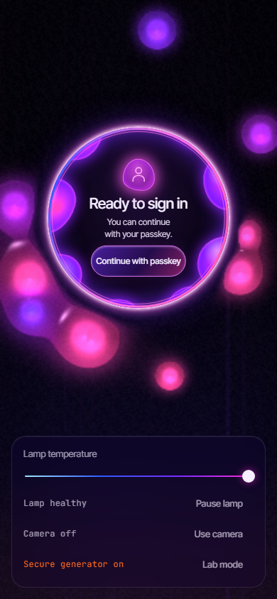
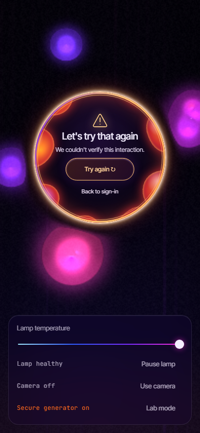
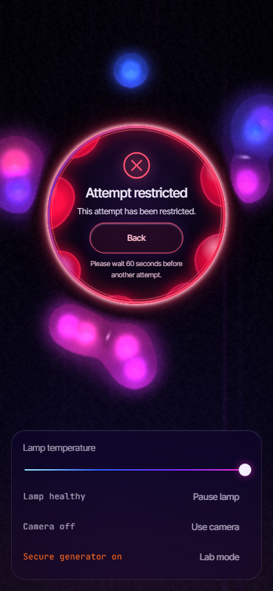
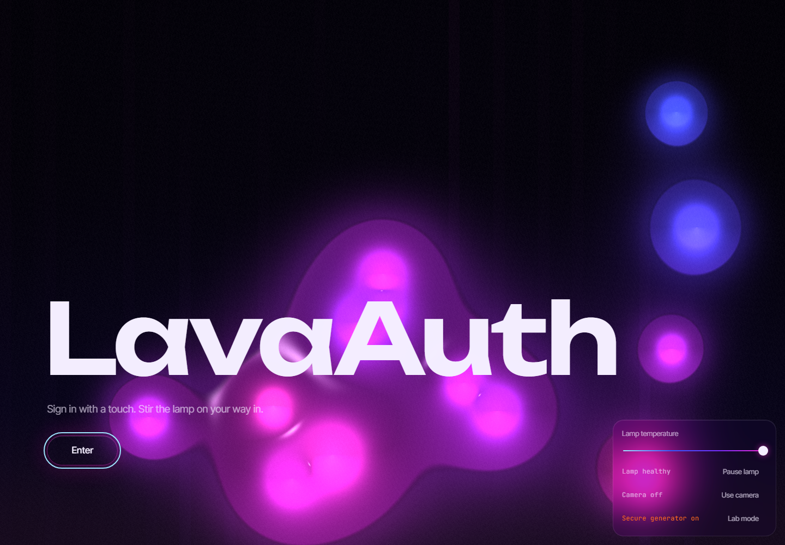
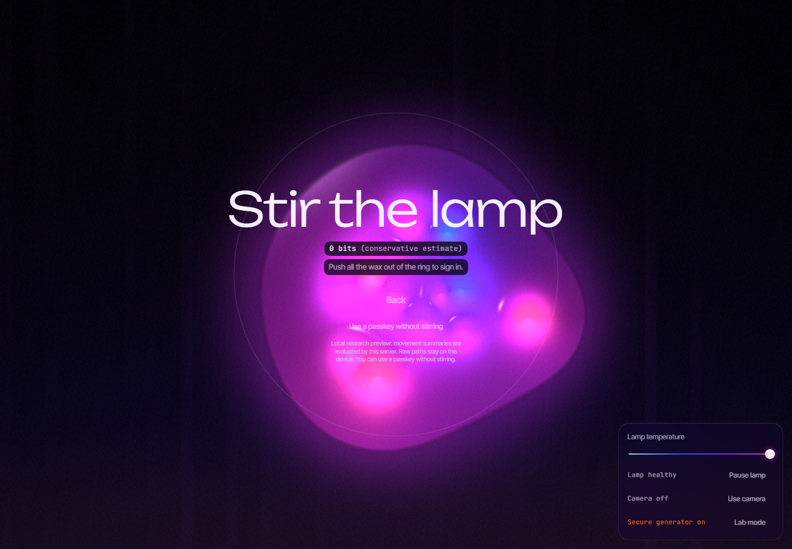
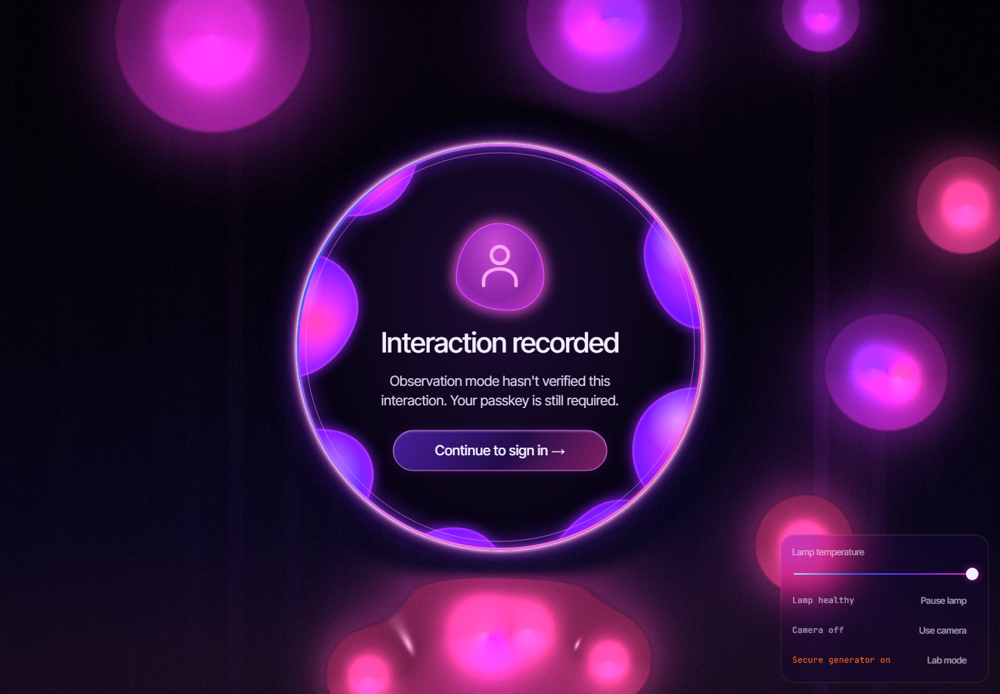
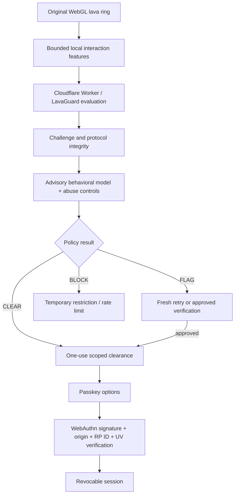

<a name="top"></a>

<div align="center">

# 🌋 LavaAuth + LavaGuard

**What if a lava lamp could sign you in—and then try to figure out whether a bot was stirring it?**

An interactive WebGL lava lamp meets passkey authentication, Cloudflare's edge platform, and an experimental behavioral anti-bot engine.

**[Try the live LavaAuth demo](https://lavaauth.yohance611.workers.dev/)** · **[Explore the code](https://github.com/Yohands123/Lava_Authentication)** · **[How it works](#how-it-works)** · **[Tests & results](#testing-and-actual-results)** · **[Roadmap](#whats-next)**

**TypeScript · WebGL 2 · Cloudflare Workers · Durable Objects · WebAuthn · Python · scikit-learn · Playwright**

</div>

> [!IMPORTANT]
> **Two release states:** The linked public demo runs the original **LavaAuth** experience. **LavaGuard research engineering is being published from `feature/lavaguard-phase5` and has not been deployed.** These screenshots describe the repository implementation. Production ML enforcement remains **off**; genuine-human false-positive rates remain unknown.

## Test it locally, repeatedly

Phase 6 local research now includes a bounded browser/API adversarial harness, private observation-only registry, dynamic-target diagnostics, leakage controls, actual local Worker benchmarks and a sharding prototype. Client-side behavior remains forgeable; passkeys provide identity security. Genuine-human validation and production eligibility remain unavailable. [Phase 6 handoff and reproduction](docs/LAVAGUARD_PHASE6_HANDOFF.md).

Run `npm run test:live` or double-click `Start-LavaGuard-Testing.cmd`, then open **http://localhost:8792**. The local panel runs 16 visible automation patterns, compares normal/advisory and older-model research profiles, supports repeat/stop, and shows actual verdicts, clearance, passkey HTTP outcomes and screenshots. It does not train or validate a Phase 5 model. [Testing guide](docs/LAVAGUARD_LOCAL_TESTING.md).

## Take a look

<p align="center">
  
  
</p>

*The original experience: move the blobs out of the circle, then continue to a passkey. The stirring looks delightfully suspicious; the actual authentication is cryptographic.*

### LavaGuard: one ring, three possible outcomes

After clearing the circle, the **same ring** becomes the result display. No new page and no generic CAPTCHA popup.

<table>
  <tr>
    <th align="center">CLEAR</th>
    <th align="center">FLAG</th>
    <th align="center">BLOCK</th>
  </tr>
  <tr>
    <td width="33%"></td>
    <td width="33%"></td>
    <td width="33%"></td>
  </tr>
  <tr>
    <td align="center">Ready to sign in</td>
    <td align="center">Try again / back to sign-in</td>
    <td align="center">Attempt restricted</td>
  </tr>
</table>

> These three images are **visual regression fixtures** with mocked verdict responses and real local rendering/stirring. They demonstrate the UI, **not proof that an ML model recognized a human or bot**. See the real-Worker test reports for security behavior.

<details>
<summary><strong>More screenshots: desktop, mobile, and the developer Lab</strong></summary>

| Original/landing | Stirring | Real Worker shadow response |
| --- | --- | --- |
|  |  |  |

The Lab includes local research views of trajectory, speed, acceleration, model evidence and consent-based data export. It is not a public production analytics dashboard.

The real Worker shadow image shows **Interaction recorded** after automated input. Shadow CLEAR permits continuation; it does not identify a human. Screenshot provenance and the publication checks are recorded in [the publication report](docs/LAVAGUARD_PUBLISH_RESULTS.md).

</details>

## What is this project?

**LavaAuth** is passwordless authentication with a fluid, interactive interface. You push animated wax out of a glowing ring; a passkey (Face ID, Touch ID, Windows Hello or a compatible security key) is what actually proves possession of an authentication credential. The server still supplies its own secure randomness even if the lamp freezes or the user supplies no useful client entropy.

**LavaGuard** is an *additional, experimental* anti-automation layer within **the same repository**. It observes a bounded set of stirring features, compares motion against research models, applies challenge/replay/abuse controls on the Worker, and issues scoped clearance to reach passkey options. It is deliberately **not** an identity check, proof of physical humanity, or a replacement for WebAuthn.

The inspiration: [Cloudflare's physical lava lamps](https://www.cloudflare.com/learning/ssl/lava-lamp-encryption/). This project's lamp is simulated, so **its pixels are not a secure random-number generator**. The security boundary is explicit, not decorative.

## Try it: what happens?

| What happens | What you see | What the backend does |
| --- | --- | --- |
| You open the application | Animated lava lamp and existing controls | Serves the app and applies applicable request limits |
| You choose sign-in | Wax gathers inside the ring | Prepares a time-limited LavaGuard attempt when enabled |
| You stir | Bubbles move out of the ring | Client extracts bounded features; Worker validates the untrusted summary |
| **CLEAR** | **Ready to sign in**, inside the original ring | Issues a scoped, expiring, single-use clearance for passkey options |
| **FLAG** | Calm **try again** state or back to sign-in | Withholds this attempt's clearance or requests an approved additional check |
| **BLOCK / restricted** | **Attempt restricted**, in the ring | Applies protocol/rate restrictions; not a permanent movement-based ban |
| You continue | Platform passkey prompt | Verifies WebAuthn challenge, origin, relying party, signature and user verification |
| Valid passkey | Signed-in experience | Creates a revocable secure session |
| No valid passkey | No authenticated session | A successful lava interaction **cannot** authenticate by itself |

When protocol checks permit continuation, the ordinary profile has **no extra CAPTCHA screen**; genuine-user acceptance has not yet been measured. Keyboard/no-WebGL accessible sign-in is available with independent abuse limits and still requires a passkey.

## How it works



**Separation of duties:** the lamp is the interaction; LavaGuard estimates automation risk and enforces protocol controls; **WebAuthn authenticates**. The Worker's cryptographically secure generator supplies **32 random bytes** to build WebAuthn challenges independently of the decorative lamp. Authentication challenges are single-use with **60-second** expiry. LavaGuard attempts use server nonces and context binding; successful scoped clearances expire after **90 seconds** and can be redeemed only once. See the [implementation and threat-model results](docs/LAVAGUARD_PHASE4_RESULTS.md) for details.

### What happens when the lamp is frozen?

The original **Freeze the Lamp** experiment still works. Animated lava is not the source of required authentication security. The system uses secure server-generated challenge randomness and mandatory passkeys whether or not the simulation is moving.

## What is LavaGuard actually detecting?

The client-side observer extracts motion features such as speed variation, acceleration, curvature, directional changes, pauses, corrections, and limited bubble-response measures. Research datasets and controlled automation generators are used to study how those signals generalize.

The system includes five modules:

| Component | Job |
| --- | --- |
| `LavaObserver` | Bounded, privacy-conscious interaction measurement |
| `LavaDetector` | Deterministic features and optional advisory ML risk |
| `LavaReputation` | Short-lived protocol-abuse history, not a permanent mouse identity |
| `LavaPolicy` | Separates risk evidence from CLEAR / FLAG / BLOCK decisions |
| `LavaEnforcer` | Issuance limits, single-use scoped clearance, replay controls and temporary restrictions |

**Important:** Mouse movements, timestamps, DOM trust flags and client-computed features are all forgeable. The browser cannot attest that a physical human moved the cursor. The model is **advisory in ordinary mode**; stronger model-based refusal remains research-only. Optional Cloudflare Turnstile step-up exists behind a disabled-by-default flag and requires server-side verification.

## The ML experiment, without the hype

LavaGuard includes a reproducible offline Python pipeline, pinned research-source metadata and integrity checks, and a compact Worker-compatible logistic inference candidate. Raw research data is obtained separately under the [documented license constraints](docs/LAVAGUARD_DATASETS.md), and is excluded from Git. The pipeline compares logistic regression, Random Forest and human anomaly detection, with held-out generator tests, preprocessing perturbations, calibration and feature ablations.

| Phase 4 experimental held-out corpus metric | Robust logistic | Robust Random Forest |
| --- | ---: | ---: |
| Research human rows accepted | 511 / 513 | 511 / 513 |
| Research human rows flagged | 2 / 513 | 2 / 513 |
| Generated bot rows detected | 34 / 777 | 211 / 777 |
| Generated bot rows missed | 743 / 777 | 566 / 777 |

**These are not production human/bot detection rates.** The research rows are not independent LavaGuard participants; source conventions, generator differences, sampling and device conditions limit transfer. As of the Phase 4 report, **zero consenting human LavaGuard study rows** were available. Known synthetic families and real Playwright/Ghost Cursor captures expose substantial remaining false negatives. No model has been promoted for production blocking.

Read [Behavioral ML: Phase 4 results](docs/LAVAGUARD_ML_PHASE4_RESULTS.md) for the fixed-model sampling sensitivity, generator-family holdouts, evaluation splits, calibration and caveats.

The [Phase 5 engineering system](docs/LAVAGUARD_PHASE5_ARCHITECTURE.md) adds strict consent/provenance, local study exports, grouped leakage controls, three classifier baselines, calibration, disabled portable inference and withdrawal. Status: **`ENGINEERING_READY_RESEARCH_DATA_PENDING`** / **`NOT_READY_NO_OPT_IN_DATA`**. Current private data contains **0 human attempts and 30 declared browser-automation attempts** (20 complete, 10 excluded incomplete). All 110 TypeScript, 37 Python and 49 browser-profile tests pass, plus 17 importer checks. Application accuracy is unknown; production ML remains off. See the [measured results](docs/LAVAGUARD_PHASE5_ML_RESULTS.md) and [full handoff](docs/LAVAGUARD_PHASE5_HANDOFF.md). Phase 5 work remains local on `feature/lavaguard-phase5`; no new push, PR or deployment.

## Testing and actual results

Phase 4 local results (reported by the development test harness; not a third-party security audit):

| Test area | Reported result |
| --- | --- |
| TypeScript/unit tests | **86 passed** |
| Real-browser E2E | **27 passed** |
| Real-Worker local enforcement | **6 normal + 6 isolated research-profile cases passed** |
| Hardening / optional verification | **8 passed**, including Siteverify using official test keys |
| Adversarial automation | **12 cases recorded**; **6 automation families** cleared the visual ring and obtained passkey options in advisory mode |
| Authenticated-session bypass with no valid passkey | **None observed** in the local credential-free test cases |
| Dependency audit | **0 reported vulnerabilities** in the tested dependency tree |
| Load and resource tests | Concurrency 1 / 4 / 16 admitted successfully; concurrency 64 / 128 deliberately returned 503s to bound overload |

**A bot clearing the ring is not the same as a bot authenticating.** Some generated cursors reach passkey options in advisory mode. A direct unguarded options request is rejected when LavaGuard protocol enforcement is enabled; however, a plausible **forged behavioral feature summary can still obtain clearance without physically stirring**. In tested cases, that did **not** bypass the separate passkey requirement.

The 503 overload responses represent real availability limitations, not successful throughput. See [Phase 4 security and staging report](docs/LAVAGUARD_PHASE4_RESULTS.md) for p50/p95/p99 latencies, bounded stores, replay cases, admission behaviour and exact commands.

## Security, privacy and limitations

| What's protected / mitigated | What is **not** guaranteed |
| --- | --- |
| Origin-bound, user-verified passkeys; public credential keys stored, never private passkey keys | A browser or device compromised by malware is not made trustworthy |
| Independent server-side challenge randomness and one-time WebAuthn verification | The simulated wax does **not** generate cryptographic entropy |
| Atomic challenge and clearance redemption, scoped expiry, replay controls | Clearance is **not** proof of a human gesture |
| Limits on issuance, evaluation, payload size and in-flight work | Distributed attackers and resource exhaustion are only mitigated |
| Accessible alternate sign-in plus separate passkey check | Movement alone cannot fairly classify every real user |
| Expiring history and aggregate-only operational metrics | Public mouse datasets do not establish application-specific model accuracy |
| Optional, server-verified Turnstile step-up in local tests | Turnstile is **off by default** and not yet live-validated with production credentials |

**Data handling:** The usual feature pipeline uses bounded summaries; the original entropy system keeps raw camera frames and snapshots local. Bounded pointer samples live in browser memory during an attempt; retaining/exporting a research trace requires separate **opt-in, local research consent**, with deletion controls. No raw upload endpoint exists. Human behavioural features can still be sensitive; production collection and ML enforcement are **off**. See [study protocol](docs/LAVAGUARD_HUMAN_STUDY.md).

**No automatic permanent behavioral bans.** Unusual movement, `navigator.webdriver`, an ML score or a suspected bot is not sufficient evidence of malicious identity. CLEAR means *permitted to continue*, not *certified human*.

## Tech stack

| Area | Technology |
| --- | --- |
| Visuals | WebGL 2 shaders, TypeScript lava/wax physics |
| Frontend | Vite + TypeScript, original lightweight UI (no frontend framework) |
| Authentication | WebAuthn / passkeys, SimpleWebAuthn, Web Crypto |
| Edge backend | Cloudflare Workers, Wrangler |
| Stateful controls | SQLite-backed Cloudflare Durable Objects |
| ML research | Python, scikit-learn, NumPy, reproducible dataset processing |
| Deployment candidate | Portable, versioned logistic inference in the Worker (currently advisory) |
| Testing | Vitest, Playwright, real local Worker/DO integration, adversarial automation |
| Tooling | ESLint, TypeScript checks, dependency auditing |

## Run locally

Requires **Node.js 24** and npm (the SQLite tests use `node:sqlite`). The Phase 4 research workflow used the pinned Python environment. A Cloudflare account is **not required just to run the local development Worker**.

```bash
git clone https://github.com/Yohands123/Lava_Authentication.git
cd Lava_Authentication
git switch feature/lavaguard
npm ci
npx playwright install chromium
npm run dev
```

Open **http://localhost:8787**. For registration/login tests, use a compatible passkey authenticator or the repository's virtual-authenticator browser suite.

### Verify the implementation

```bash
npm run check           # TypeScript + ESLint + unit tests on the feature branch
npm run build
npm run test:e2e        # Chromium / local Worker tests
npm run test:enforce    # protocol enforcement
# Windows PowerShell: $env:LAVAGUARD_RESEARCH='1'; npm run test:enforce; Remove-Item Env:LAVAGUARD_RESEARCH
# Unix research profile: LAVAGUARD_RESEARCH=1 npm run test:enforce
npm run test:hardening  # rate limits, Turnstile test path and recovery
npm run test:adversarial
npm run test:load       # local workerd only; intentional 429/503 may occur
npm audit
```

The optional offline ML workflow needs the separately configured Python environment and permitted local datasets. See [dataset documentation](docs/LAVAGUARD_DATASETS.md) and [ML results](docs/LAVAGUARD_ML_PHASE4_RESULTS.md); do not assume bundled research datasets or private human traces are committed to Git.

> [!CAUTION]
> **`npm run deploy` publishes to Cloudflare.** Do not run it while simply publishing documentation or pushing the GitHub branch. The live site should remain unchanged until an explicitly reviewed staging/production release.

## Code map

```text
src/
  client/
    lamp/                 # WebGL renderer, shaders, wax physics
    stir/                 # Pointer interaction and original entropy pool
    guard/                # LavaGuard observer/orchestration/research controls
    ui/verdict.*          # In-circle CLEAR / FLAG / BLOCK states
  shared/                 # Shared feature extraction and types
  worker/
    routes/lavaguard.ts  # Worker API for challenge/risk evaluation
    guard/                # Policy, reputation, inference and enforcement
    durable/              # Challenge and other state stores
ml/                      # Dataset ingestion, training, validation, artifacts
scripts/                 # Local attack, test, performance and import harnesses
tests/                   # Unit, real-Worker and browser checks
docs/media/lavaguard/    # Captured UI screenshots (publish safe images only)
```

## What's next?

The authentication runtime preserves Phase 4 controls; **Phase 5 research engineering is implemented locally**, with empirical human validation pending. No genuine-user study has begun. Before moving beyond the research stage:

1. **Phase 5 — Consenting real-user study:** collect genuine bubble-interaction sessions across devices and independent participants, measure acceptance, retries, and accessibility.
2. **Improve ML generalization:** use matched human and bot instrumentation, independent generator families, calibrated operating points, and meaningful false-positive constraints.
3. **Controlled staging:** protocol enforcement and *shadow* model evaluation with explicit owner approval, strict budgets, opt-in collection, live-device checks and rollback.
4. **Careful promotion:** only consider ML-based FLAG after real application evidence supports it; keep permanent bans tied to reviewed, corroborated abuse rather than movement scores.
5. **Visual polish:** continue refining the glass/wax results and performance on real mobile GPUs without changing the distinctive stir-the-ring interaction.

There is no claim that LavaGuard is currently a production-grade CAPTCHA. Its value today is the **transparent engineering experiment**: build a defensive system, attack it with real browser automation, measure where it fails, and improve without making life harder for genuine users.

## Documentation

- [Phase 5 Automation Environment Evidence: measured coverage, spoofability and shortcut risks](docs/LAVAGUARD_AUTOMATION_ENVIRONMENT.md) — local, consented advisory hints; no AI identity or population accuracy claim.
- [Phase 4 security, threat model and load/staging results](docs/LAVAGUARD_PHASE4_RESULTS.md)
- [Phase 4 behavioral ML results](docs/LAVAGUARD_ML_PHASE4_RESULTS.md)
- [Human study protocol](docs/LAVAGUARD_HUMAN_STUDY.md)
- [Dataset provenance and access](docs/LAVAGUARD_DATASETS.md)
- [Staging configuration and rollback](docs/LAVAGUARD_STAGING.md)
- [Design guidelines](DESIGN.md)

## License

Released under the [MIT License](LICENSE). Built as a tribute to the creativity of Cloudflare's entropy wall, not an official Cloudflare product.

<div align="center">

**The lava is simulated. The security questions are real.**

[Live original demo](https://lavaauth.yohance611.workers.dev/) · [Back to top](#top)

</div>
