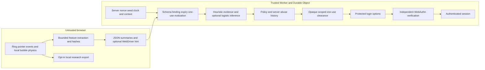

# LavaGuard Phase 2 results — 2026-10-17

## Decision and human retry correction

Keep movement classification advisory. The owner reported four retries and confirmed they were operating the Playwright demo browser manually. That browser continues reporting `navigator.webdriver=true` during human takeover. The previous detector gave that hint enough weight to FLAG by itself; an unvalidated public-corpus mouse classifier could independently FLAG as well. This was an inappropriate rejection policy. The exact four model scores were not retained, so those scores cannot be reconstructed. Four reported retries are a usability failure, not a measured population false-positive rate.

Normal localhost now uses `enforce` for protocol controls and `LAVAGUARD_EXPERIMENTAL_MODEL=0`. WebDriver, smoothness, sample scarcity, repeated geometry and movement anomalies remain advisory. A claimed duration exceeding the server's elapsed time by more than 1.5 seconds can still FLAG. Missing telemetry cannot mint clearance. Verified repeated protocol violations can temporarily restrict issuance. The separate model-enforcement profile is opt-in, localhost-only, and used for experiments. Production remains off, with model and Lab disabled; no deploy, merge or production collection occurred.

CLEAR says **Ready to sign in**, with the approved circle and actions preserved. It never asserts human detection, even in the research profile. Shadow continues to say **Interaction recorded**. Accessible sign-in remains independently rate limited and requires a verified passkey. Disabling unreliable movement refusal also permits some automation to request passkey options. That is an explicit tradeoff, not a successful human classifier claim.

## Verified pipeline and trust boundary



| Stage | Independently checked | Remaining untrusted claim |
| --- | --- | --- |
| Pointer/physics | None on server | Coordinates, timing, trust bits, device, bubble state and ring completion |
| Feature extraction | Exact version, finite complete numeric fields, bounded ratios/counts, 8 KB request cap | All aggregate values and both 43-character hashes can be fabricated |
| Attempt | Crypto-random ID, 32-byte nonce, seed, 120-second expiry, context/origin/kind binding; consume once | Cookie context is a resettable browser pseudonym, not an identity |
| Detection | Duration claim compared with server clock; optional deterministic inference | An inference over fabricated features is still fabricated evidence |
| Policy | Server rates/history, known-used attempts, bad nonce, cross-context attempts, missing summaries | Movement similarity and WebDriver cannot identify the operator |
| Clearance | Random 32-byte opaque token, 90-second expiry, context/origin/scope binding; atomic consume | Possession is not human attestation |
| Authentication | Original server randomness, single-use WebAuthn challenges, RP ID/origin/UV/signature/counter; secure opaque session | CLEAR never substitutes for a valid authenticator assertion |

Source: `src/client/guard/observer.ts`, `src/shared/features.ts`, `src/worker/routes/lavaguard.ts`, `src/worker/guard/`, `src/worker/durable/ChallengeStore.ts`, login routes. Critical DO SQL reads/deletes/inserts remain synchronous before yielding. New cross-context and missing-summary violations are recorded against the calling context, without spending another context's challenge. Clock injection is used consistently in lifecycle tests.

The deployed inference code available to the Worker is the fixed 15-feature standardized, sigmoid-calibrated logistic artifact. RF and Isolation Forest run offline only. The localhost Lab can compute the logistic score for observation even with enforcement disabled. Touch/pen never activate the mouse model for policy. No absence of WebDriver is human evidence.

OFF refuses submitted movement summaries and preserves the original login-options flow without a LavaGuard token. SHADOW evaluates disclosed summaries and permits valid attempts despite movement evidence, while still requiring one-use clearance. ENFORCE applies protocol refusal and, only with explicit localhost opt-in, model refusal. Restrictions from actual protocol abuse/rates remain independent of movement in all profiles. Attempt history is bounded to 16 recent rows per context and expires after ten minutes; review audit expires after 24 hours.

The server-issued seed currently does **not** drive an attested physical simulation. Binding a nonce prevents replaying the same attempt, but does not prove a client cleared its ring. Uploading a self-reported physics hash would not repair this. Original visual physics and the approved interaction were preserved.

## Audit of all twelve historical cases

`ml/artifacts/adversarial.json` is the historical shadow harness. Nine recorded server CLEARs and model scores belong to a **second synthetic challenge**, not necessarily to the browser's original ring attempt. Those fields cannot establish original-browser classification or clearance. Original-browser clearance and protected-options status were not recorded for the first ten cases. They are explicitly unknown in `ml/artifacts/phase2-history-audit.json`; no missing observation is converted into a security success.

| Family | Ring cleared | Recorded second-evaluation model score | Second-evaluation decision | Original clearance | Protected options | Session |
| --- | --- | ---: | --- | --- | --- | ---: |
| linear | No | 0.082902 | CLEAR | Unknown | Unknown | 401 |
| circle | No | 0.829965 | CLEAR | Unknown | Unknown | 401 |
| random | Yes | 0.961903 | CLEAR | Unknown | Unknown | 401 |
| bezier | No | 0.106208 | CLEAR | Unknown | Unknown | 401 |
| variable-speed | Yes | 0.896467 | CLEAR | Unknown | Unknown | 401 |
| corrections | Yes | 0.965915 | CLEAR | Unknown | Unknown | 401 |
| lognormal proxy | Yes | 0.351148 | CLEAR | Unknown | Unknown | 401 |
| DOM synthetic | No | 0.965915 | CLEAR | Unknown | Unknown | 401 |
| Ghost Cursor | Yes | 0.999990 | CLEAR | Unknown | Unknown | 401 |
| Puppeteer corrections | No | Not computed/recorded | Not recorded | Unknown | Unknown | 401 |
| direct API | N/A | N/A | No evaluation | None supplied | 403 | 401 |
| forged verdict | N/A | N/A | No evaluation | None supplied | 400 | 401 |

These observations establish several visual completions and zero observed authenticated-session bypasses. Shadow CLEAR was policy behavior, not successful human identification. The historical per-family offline `enforceVerdict` fields do not show enforcement by a real Worker.

## Independently reproduced adversarial run

`npm run test:adversarial` now captures the **actual browser-issued evaluation response**, its actual token presence, a real request to protected options and `/api/session`. It uses fixed generator seed 42 and the real Ghost Cursor/Puppeteer libraries, without forced responses. Browser scheduling and the original visual physics are not deterministic; completion differences between runs are expected. Offline generator scoring is separately named.

Current ordinary local configuration: protocol ENFORCE, movement model advisory. Artifact: `ml/artifacts/adversarial-phase2.json`.

| Family | Ring cleared | Actual model score (advisory) | Actual decision | Clearance | Options status | Session |
| --- | --- | ---: | --- | --- | ---: | ---: |
| linear | No | Not computed | None | No | 403 | 401 |
| circle | No | Not computed | None | No | 403 | 401 |
| random | Yes | 0.990405 | CLEAR | Yes | 200 | 401 |
| bezier | Yes | 0.103684 | CLEAR | Yes | 200 | 401 |
| variable-speed | Yes | 0.555761 | CLEAR | Yes | 200 | 401 |
| corrections | Yes | 0.887852 | CLEAR | Yes | 200 | 401 |
| lognormal proxy | No | Not computed | None | No | 403 | 401 |
| DOM synthetic | No | Not computed | None | No | 403 | 401 |
| Ghost Cursor | Yes | 0.997558 | CLEAR | Yes | 200 | 401 |
| Puppeteer corrections | No | Not computed | None | No | 403 | 401 |
| direct API | N/A | N/A | No evaluation | No | 403 | 401 |
| forged verdict | N/A | N/A | No evaluation | No | 400 | 401 |

Five visual completions obtained options under advisory movement policy. No case authenticated. The low-scoring Bézier completion is a concrete remaining classifier false negative; high-scoring random/Ghost Cursor cases proceed intentionally in advisory mode. An unfinished ring has no decision and cannot be counted as detector success.

## Actual local enforcement

`playwright.enforce.config.ts` uses a fresh isolated local Durable Object directory and port 8786. Normal and opt-in research profiles use the same production Worker handlers, SQL and passkey code. No security verdict response is mocked. UI screenshot fixtures in the separate visual suite are explicitly mocked for presentation only.

Verified behaviors:

- Original scripted stirring with reported and hidden WebDriver: normal policy CLEAR with honest wording; research model policy FLAG with no token. The browser hint alone no longer determines either decision.
- Missing summaries FLAG without clearance; altered challenge IDs return 409; server-inconsistent duration FLAGS without clearance; unguarded options return 403.
- Fabricated plausible aggregates from a generated straight path obtain CLEAR and options **without visiting the ring**, including in the strict model profile. This is a reproduced detection/gesture-gate bypass. The session remains 401; WebAuthn authentication remains required.
- A different valid cookie context cannot evaluate another context's attempt or redeem its token. Rejected theft does not consume the owner's valid attempt/token.
- Concurrent evaluations have one 200 and one 409. Concurrent options redemption has one 200 and one 403. A bad nonce spends the attempt; the later correct nonce returns 409.
- The accessible path still completes independently verified WebAuthn with the test virtual authenticator. Its permitted options are an explicit supported alternative, not human classification.
- Existing real-Worker shadow tests also cover temporary restriction after three protocol replays and malformed/oversize requests. Exact expiry, scope, bounded storage and retention alarms use the production SQL with an injected clock in unit tests; they are not represented as real-time 90-second browser waits.

Per-IP issuance/evaluation limits, per-context gesture/accessible limits, three pending challenges and ten-minute bounded history remain active. Local harnesses cannot prove resistance to distributed issuance or cookie reset. No movement evidence creates a permanent ban; the research model can only withhold this attempt's token.

## Generalization and false-positive measurements

`ml/validate.py` writes `ml/artifacts/phase2-generalization.json` and never changes a model artifact. All hyperparameters are the Phase 1 defaults; thresholds 0.5 and 0.9 are declared before evaluation. The original fixed train/calibration/test membership is preserved for ablations. No final model or threshold was selected from these results. Logistic calibration uses separate groups; RF is evaluated as its existing uncalibrated score. Isolation Forest remains an anomaly baseline.

Dataset audit: 955 upstream human and 2,596 upstream bot normalized traces. The >=12-sample filter excludes **11 humans and 1,229 bots**, a substantial selection bias. Feature extraction plus 280 declared local generated traces yields 2,591 rows. Deduplication removes 78 model vectors, with zero conflicting duplicate labels; the public normalized paths have zero exact rounded duplicates. There are 2,513 unique model vectors. Metadata IDs/source/device/labels are not predictors, but source, task, duration and acquisition conventions can still leak through kinematics. Public traces normalize by trajectory extent; the application normalizes by ring diameter. Participant identity is unavailable in this public corpus; pc1/pc2 folders cannot prove participant independence.

At the experimental rejection threshold **0.9**, on the original 513-human/777-bot held-out corpus:

| Experiment | Logistic human false positives | Logistic bots detected | RF human false positives | RF bots detected |
| --- | ---: | ---: | ---: | ---: |
| All 15 features | 10/513 (1.95%) | 687/777 (88.42%) | 6/513 | 21/777 |
| Remove timing/pause/bursts | 1/513 | 57/777 | 3/513 | 0/777 |
| Remove count features | 10/513 | 579/777 | 4/513 | 15/777 |
| Shape only | 0/513 | 0/777 | 52/513 | 0/777 |
| Five kinematic features | 0/513 | 97/777 | 4/513 | 3/777 |
| Acquisition-only control | 53/513 | 199/777 | 11/513 | 80/777 |

The logistic model's Brier score is 0.048858 and ten-bin expected calibration error is 0.061561; RF is 0.031802 and 0.131074 respectively. Calibration bins and both thresholds are in the artifact. At 0.5 the historical RF detects 777/777, but its score is not calibrated to justify using a 0.9 threshold; reporting only its earlier accuracy would hide that limitation. Human Isolation Forest marks 74/513 humans and 776/777 generated held-out rows anomalous. Anomaly does not imply automation.

Matched 32 ms cadence, with linear interpolation of existing traces and original split membership, produces logistic 0/513 human flags but only **92/777 generated detections (11.84%)** at 0.9. No post-resampling train/test duplicate vectors were found. This is an acquisition sensitivity control, not a validated alternative model or new independent dataset. The collapse from 687 to 92 detections is evidence that original results depend heavily on sampling conventions.

Leave-one-generator-family-out results, logistic threshold 0.9:

| Held-out bot family | Bot detections | Human flags (same held-out 513, reused) |
| --- | ---: | ---: |
| DELBOT GAN | 697/697 | 10 |
| DELBOT NaturalMouseMotion | 16/234 | 0 |
| DELBOT pyhm | 11/55 | 8 |
| DELBOT pynput | 324/381 | 8 |
| Local Bézier | 0/40 | 8 |
| Local circle | 0/1 | 8 |
| Local corrections | 0/40 | 8 |
| Local linear | 0/1 | 8 |
| Local lognormal proxy | 0/40 | 8 |
| Local random | 0/40 | 9 |
| Local variable speed | 0/40 | 8 |

Linear/circle have one unique vector after deduplication; 40 seeded duplicates are not 40 independent successes. Every fold excludes its bot family from fitting and calibration, retains the public human holdout and fits/calibrates new descriptive baselines. All RF/anomaly comparisons are in the artifact. Do not pool the reused humans across folds into a larger sample size.

Cross-source evaluation fits DELBOT-only training/calibration and tests the independent local generator source: logistic detects 50/202 unique generated traces at 0.9. That source has no humans, so its human FPR is **unavailable**. A full second independent human-corpus evaluation remains unavailable; restricted or unclear-license sources were not imported. The validator supports optional consenting application imports and participant-disjoint splits when enough participants exist. Current application human sample count is **zero**. No claim of production accuracy, trackpad/touch acceptance or resolution of every human rejection is justified.

The exact original StirMeter code was evaluated on 2,591 normalized input trajectories: its credit meter completed for 10/944 upstream human rows and 92/1,647 generated rows. These short circle-task traces are generally shorter than a complete LavaAuth interaction; treating incomplete credit as a human false positive would be invalid. This is a baseline of crediting behavior, not visual ring clearance or bot probability. Artifact: `phase2-stirmeter.json`. No additional neural network or LightGBM was justified or added.

## Bubble-response benchmark and consent workflow

The original renderer/physics/constants and stirring mechanics are unchanged. The observer now locally associates a stable ephemeral object ID with the nearest uncleared bubble, records normalized target coordinates and computes a research-only response summary. Target switches/splits are excluded from displacement continuity. New measurements cover large displacements, sharp moving-target turns, subsequent cursor direction corrections, sample-limited response latency and mean/p95 tracking error. No new target fields are uploaded in ordinary feature summaries, and none controls policy.

`scripts/research-benchmarks.mjs` runs 18 deterministic synthetic cases over seeds 42, 812 and 20261017: delayed/immediate reactive agents, moving-target reactive/independent trajectories, target-independent trajectories and exactly repeated cursor paths across different arrangements. For seed 42, a 160 ms reactive bot has tracking error 0.108886; the identical cursor path against another arrangement has error 0.329246 and the exact same path hash. Moving-target cases contain six detected turns. The immediate reactive bot appears at 32 ms resolution because the algorithm searches subsequent samples; it is not a measured human reaction. A target-independent path still receives ten apparent post-displacement corrections in one case: chance alignment is a confound. These are reproducible research features, not human-presence proof. Artifact: `phase2-bubble-response.json`.

The restricted existing Lab now requires consent before each retained attempt and offers mouse/trackpad/touch/pen/assistive selection, self-reported labels, random participant study codes, local-only one-attempt export and deletion. It snapshots consent/label/device at attempt start. Opting in afterward does not recover a trace. Page hide and consent withdrawal clear retained research; export excludes clearance/cookies/account/passkey data. No localStorage tracking or automatic raw upload was introduced. Server-deletion failures are reported. Raw downloaded copies require separate filesystem deletion.

`scripts/import-consenting.mjs` explicitly imports consenting exports to ignored derived feature rows, rejects unlabeled/invalid consent, deduplicates attempt IDs and preserves participant grouping. `ml/validate.py` supports source transfer and participant-disjoint splitting with enough real study IDs, without manufacturing missing labels. [Study instructions and privacy scope](LAVAGUARD_HUMAN_STUDY.md) describe recruitment, export, deletion and the distinction between self reports and attestation. No human rows were collected during implementation. Automated consent-flow tests are declared automation and never enter human evaluation.

## Verification and next stage

At the owner's request, a headed Chromium research preview on port 8785 repeated the original automated stir and then clicked the actual **Try again** button. Both actual evaluations returned FLAG, both withheld clearance, both protected-options probes returned 403, and both sessions remained 401. A different server challenge was issued on retry. Recorded model scores were 0.999999416 and 0.999924321. No response was mocked and no assertion authenticated. The ordinary participant preview on 8787 retained advisory model settings. Evidence: `ml/artifacts/preview-retry-phase2.json`, `docs/media/lavaguard/retry-first.png` and `retry-second.png`; reproducible driver: `scripts/preview-retry.mjs` with the isolated local research Worker described below.

```powershell
npx wrangler dev --port 8785 --persist-to .wrangler/retry-preview-20261017 --var ORIGIN:http://localhost:8785 --var LAVAGUARD_MODE:enforce --var LAVAGUARD_EXPERIMENTAL_MODEL:1
# Another terminal:
node scripts/preview-retry.mjs
```

Actual command results:

| Command | Observed output |
| --- | --- |
| Starting `npm test` | 12 files, 72 tests passed |
| Final `npm run check` | Both TypeScript targets passed; 13 files, 75 tests passed |
| `npm run test:e2e` | 27 passed (3.2 minutes), including all in-circle layouts and local consent/export/delete |
| `npm run test:enforce` | 6 passed (24.7 seconds), normal protocol profile |
| `$env:LAVAGUARD_RESEARCH='1'; npm run test:enforce` | 6 passed (17.4 seconds), isolated strict model profile |
| Strict focused protocol rerun after rejecting empty summaries | 3 passed (5.5 seconds); empty summary 400, fabricated plausible summary still reaches options |
| Vite build, invoked by both browser configurations | Passed; original renderer/physics retained |
| `npm run test:adversarial` | 12 actual local cases written to `adversarial-phase2.json` |
| `node scripts/audit-adversarial-history.mjs` | 12 historical cases audited and 12 reproduced cases linked; unrecorded fields explicitly null |
| `node scripts/research-benchmarks.mjs` | 2,591 StirMeter rows, 2,591 resampled rows, 18 synthetic bubble cases |
| `.venv/Scripts/python ml/validate.py` | 2,513 unique model vectors, 11 held-out generator families, six ablations, zero consenting application rows |
| `node scripts/check-consent-import.mjs` | Valid declared-automation export accepted; absent consent/unlabeled/missing code/empty trace rejected; study corpus unchanged |
| `node scripts/preview-retry.mjs` | Actual FLAG then click Try again then actual FLAG; fresh challenge, no tokens, options 403, session 401 |
| Python compile and Node syntax checks | Passed for updated pipeline/import/preview scripts |
| `git diff --check` | Passed |
| Final ordinary localhost config | `mode=enforce`, `experimentalModel=false`, `lab=true` |

The developer server remains on `http://localhost:8787`; the requested visible research retry runs separately on 8785. Automatic approval review blocked opening the user's regular browser and provided no detailed reason; the Playwright test browser opened successfully. No deploy, merge, production policy change, model artifact promotion or human-data fabrication occurred.

The next stage should be a consent-based study in ordinary browsers with participant-disjoint repeated attempts and device-specific acceptance/abandonment/timing measurements. Keep the model advisory until those measurements support an explicit promotion decision. The reproduced forged-summary path and lack of attested client physics remain architectural limitations. Preserve independent passkey verification as the authentication boundary.
