# LavaGuard Phase 4 — security and staging results

Implementation and measurements are local. No deploy, merge, remote resource creation, production credential request or production ML activation occurred. Production remains off. Original wax physics, shaders, stirring and passkey authentication were preserved. The in-circle result remains CLEAR/FLAG/BLOCK; BLOCK now uses neutral **Attempt restricted** wording. Optional verification controls are hidden by default.

## Threat model and trust boundaries

| Attack | Classification | Verified boundary / limitation |
| --- | --- | --- |
| Direct API without clearance | Prevented in enforce/shadow | Real options request returns 403 |
| Plausible forged aggregates without ring | Fundamentally unresolved as human evidence | Normal profile still permits options; actual session remains 401 |
| Rapid forged aggregate | Mitigated with optional step-up | With provider enabled, sub-200-ms gesture evaluation or established protocol history requests independently verified escalation; a delayed forgery remains possible |
| Ring-clearing Playwright/Ghost Cursor | Visual completion reproduced | Six evaluated families completed and obtained options under advisory policy; no authenticated bypass |
| Challenge/nonce replay | Prevented for the same attempt | Atomic consume; altered/used IDs and bad nonces fail; new attempts are possible |
| Clearance replay/concurrent redemption | Prevented for the same token | One winner; context/origin/scope and expiry checked |
| Cross-session/context theft | Prevented without the matching context | Does not establish a persistent person identity; stolen cookie plus token is outside that guarantee |
| Cookie reset | Partially mitigated, identity unresolved | Broader per-network and global limits remain; new context/deletion cannot establish continuity |
| Distributed issuance | Mitigated | Global budget, storage caps, per-isolate admission; distributed identity remains unresolved and shared budgets can deny legitimate traffic |
| Resource exhaustion | Mitigated, not eliminated | Size/time bounds, bounded queues/storage/counters; controlled overload returns retryable 503; development-runtime limits remain |
| Imitated human motion | Fundamentally unresolved | Client values can be fabricated independently of any classifier |
| Genuine-user false positives | Mitigated by advisory model | No production model promotion or claims of application acceptance; real study corpus absent |

```mermaid
flowchart LR
  B[Untrusted browser: ring, features, hashes] --> G[Size/time bounds and admission]
  G --> R[Server rate controls and context binding]
  R --> D[Atomic attempt evaluation and advisory ML]
  D -->|permitted| C[Scoped one-use LavaGuard clearance]
  D -->|optional escalation| T[Bound pending verification]
  T --> S[Server-only Cloudflare Siteverify]
  S -->|validated and consumed once| C
  C --> O[Passkey options]
  O --> W[Independent WebAuthn assertion verification]
  W --> A[Authenticated session]
```

Nothing in browser physics, a client hash, a seed, WebDriver, a timestamp or ML attests physical human input. IP budgets protect resources; IP is not a user identity. No fingerprint-based identity was added.

## Weaknesses found and implemented fixes

The previous guard had only local history bounds, no global storage capacity, and rate objects with no expiration cleanup. Most authentication routes parsed unbounded JSON. The load harness originally shared live build output with other tests, allowing reloads to interrupt measurements.

Implemented:

- Streaming JSON byte and three-second read bounds: 8 KB guard bodies and 32 KB authentication bodies, including chunked or dishonest Content-Length cases.
- Atomic synchronous SQLite rate counters, saturation independent of the requested limit, and expiration alarms. Switching accessible/gesture limits cannot reduce a shared counter. Alarm scheduling occurs once per window and storage can be recreated safely after cleanup.
- Global issuance/evaluation/verification budgets in addition to existing context/network limits. No permanent behavioral bans.
- Three pending attempts and at most three live clearances per context. Global attempt/clearance caps 4,096; history 8,192; audit 1,024; pending optional verifications 2,048; verification-token hashes 4,096; aggregate metric rows 2,048. Expiry indexes and alarm scheduling cover additive guard tables.
- Per-isolate admission of at most 16 ordinary guard mutations and four in-flight verification requests. Overflow is 503 with Retry-After, not a human/bot judgment. It does not impose a global concurrency guarantee across Cloudflare isolates.
- Explicit pending optional verification, atomic reservation before network work, globally one-use token hashes, context/origin binding and post-validation recheck. A failed/aborted/expired operation never silently grants clearance.
- Fixed aggregate metric labels, 24-hour expiry, admin-only access, separate policy/model versions and best-effort noncritical latency recording. Production metrics remain disabled.
- Frozen Worker/assets snapshots for load testing, with bundle hash recorded, plus separate asset output per browser-test profile. This corrects dev-reload and shared-build interference without disguising failed runs.
- Real ESLint 10 and TypeScript ESLint rules replace the old typecheck alias. Typechecks remain separate and `npm run check` runs both lint and tests.

Existing server cryptographic randomness, WebAuthn challenge construction/consumption, origin/RP ID/UV/signature/counter verification and secure session cookies were retained. Node SQLite unit fixtures run the production SQL; browser/API security tests run actual local Workers without mocked decisions.

## Reproduced attacks and independent verification

`ml/artifacts/adversarial-phase4.json` captures the actual browser evaluation, token presence, actual options status and session status. The original twelve families use fixed seed 42; physics and browser scheduling remain nondeterministic.

| Case/family | Visual completion | Actual decision | Clearance/options | Authentication |
| --- | --- | --- | --- | --- |
| random, Bézier, variable speed, corrections, lognormal proxy, Ghost Cursor | Yes, six families | CLEAR under advisory policy | Token issued; options 200 | Every session 401 |
| linear, circle, DOM synthetic, Puppeteer corrections | No | No evaluated result | No token; options 403 | Every session 401 |
| direct API | N/A | No evaluation | Options 403 | Session 401 |
| forged verdict fields | N/A | No evaluation | Options 400 | Session 401 |

An unfinished ring is not detector success. Getting passkey options is not authentication. Six real automation captures are also scored by the frozen candidate in `phase4-browser-model.json`; they were excluded from fitting and threshold selection.

Actual Worker regression suites additionally exercise missing/empty/oversized telemetry, altered challenge IDs, impossible duration, concurrent evaluation, bad nonce spending, wrong context, token replay, concurrent options redemption, invalid session cookies, high-volume issuance and switching rate-limit kinds. The no-ring fabricated-summary regression remains intentionally successful at obtaining options, followed by unauthenticated session 401. A delayed 250-ms forgery also demonstrates the optional rapid-request heuristic's limit.

With optional verification enabled, a rapid forgery instead returns FLAG with no clearance. A different valid cookie context cannot redeem its pending verification. Cloudflare's real Siteverify endpoint was called with official public test credentials; success issued one application clearance, later token replay failed, and parallel redemption had one winner. The accessible route cannot drop an already required verification. Mobile keyboard/network-failure tests keep the original circle and do not grant clearance when widget loading fails. Failure and real hostname/action/binding/age rejection paths also have unit coverage; real staging-account credentials were unavailable and were not requested.

## Turnstile status and limits

Implemented, **disabled by default**. Real credentials require success, current token age, exact ORIGIN hostname, action `lava_guard` and pending-attempt ID in `cdata`. No secret is returned to the browser. A missing configuration/service failure does not become CLEAR. Cancel/expiry/retry leave the user able to restart; the independent passkey boundary remains mandatory.

Cloudflare's documented dummy keys returned `example.com` and testing metadata in the actual local call, without usable action/cdata. The exception requires explicit localhost-only test mode and test metadata; dummy secrets are rejected on non-local origins. Token hashes remain globally one-use even for the dummy constant. A real-Worker test caught unsupported redirect behavior; using manual redirect handling fixed validation, without following arbitrary redirects or weakening TLS. [Server validation](https://developers.cloudflare.com/turnstile/get-started/server-side-validation/), [official test keys](https://developers.cloudflare.com/turnstile/troubleshooting/testing/) and [CSP guidance](https://developers.cloudflare.com/turnstile/reference/content-security-policy/) informed implementation.

LavaGuard clearance is an opaque, 90-second application token bound to context/origin/login-options. Turnstile validation does not automatically create Cloudflare's `cf_clearance` managed clearance cookie; pre-clearance is not enabled. Neither token substitutes for a passkey or guarantees humanity.

## Load, contention and resource limits

`npm run test:load` runs only local workerd/DO SQLite at port 8783, with frozen code/assets, fresh stores, synthetic reserved client addresses and no public-service load. Final artifact: `phase4-load.json`; it records the Worker bundle hash, p50/p95/p99, success throughput, expected 429/503, unexpected errors, CPU, RSS, contention/redemption and aggregate stored-row counts.

Final concurrency 1/4/16: every issuance and evaluation succeeded. At concurrency 64/128, deliberate admission rejects excess work, preserving bounded processing. No unexpected 500 or transport failure occurred in the final frozen run. **503s are availability failures**, not successful service, and are reported separately rather than removed from the results. Evaluation rows whose issuance was denied are explicitly marked skipped; they are not invented network calls.

| Concurrency | Issue successes / attempts | Successful issues/s | Issue p95 / p99 ms | Evaluation successes / actual requests |
| --- | --- | ---: | ---: | --- |
| 1 | 64/64 | 19.35 | 61.45 / 64.18 | 64/64 |
| 4 | 64/64 | 26.70 | 193.06 / 288.71 | 64/64 |
| 16 | 64/64 | 27.30 | 764.74 / 1334.72 | 64/64 |
| 64 | 33/64, 31 overload 503 | 23.48 | 1396.84 / 1400.29 | 17/33, 16 overload 503; 31 skipped |
| 128 | 33/128, 95 overload 503 | 24.33 | 1347.61 / 1348.02 | 17/33, 16 overload 503; 95 skipped |

Evaluation p50/p95/p99 milliseconds, excluding skipped non-requests: concurrency 1: 39.46/45.90/61.35; 4: 123.73/148.06/185.47; 16: 507.58/545.08/552.74; 64: 647.01/649.93/650.16; 128: 603.36/605.16/605.21. The latter two each have 16 deliberate 503s among 33 actual evaluation requests (48.48% availability-error rate); skipped evaluations are not included in latency/rate denominators.

Throughput plateaus around concurrency 16 while latency grows; concurrency 64/128 exceeds the safe local admission budget. At those levels issuance availability-error fractions are 48.44% and 74.22%, deliberately 503. Local workerd RSS peaks ranged about 80–108 MiB across final phases; CPU deltas were 0.48–1.66 seconds per phase, which includes abuse/recovery probes and is not per-request edge CPU. Measurements are machine/development-runtime dependent.

Eight simultaneous redemptions in every phase produced one 200 and seven 403. Session remained 401. Low-concurrency 40-request cookie-reset bursts produced 30 accepted and ten 429; higher bursts can hit admission first. The final distributed-issuance probe (320 requests at concurrency eight after earlier traffic) produced 240 accepted and 80 global 429, with no unexpected errors. This does not imply 240 is a configured limit: previous phase traffic consumed part of the fixed window.

Before admission, a frozen local run exhibited ProxyWorker connection-loss 500s under high fan-out: 29/128 evaluation errors at concurrency 128, plus increasing latency. `phase4-load-before-admission.json` retains that observation. Earlier live-build runs were invalidated by development reloads and are preserved separately as `phase4-load-initial.json`; they are not capacity evidence. Admission reduced practical uncontrolled failure in the final run by explicitly refusing overload; it did not increase available capacity or prove that distributed DoS is solved.

These are local observational runs, with different admitted request counts and host activity; they are not a statistically controlled speedup measurement. Raw snapshots and deliberate admission refusals remain visible in the artifacts.

Production SQL cleanup functions deleted 8,192 expired attempts and 8,192 expired history rows in 19.53 ms locally, leaving zero. Artifact `phase4-cleanup.json` uses in-memory SQLite and an injected clock; it is not a real edge alarm-duration measurement. Expiry/alarm scheduling also has lifecycle tests. Real staged alarm, billing and multi-isolate performance require approved observation.

An additional actual Worker smoke reached eight permitted accessible requests then 429, waited 62 seconds, and obtained 200 again after window expiry/cleanup, with session still 401. The rate alarm checks the stored expiry before deleting, so a delayed/retried older alarm cannot erase a newly active window. Artifact `phase4-rate-expiry.json` records the real-time recovery. Empty DO namespace identities/metadata are not deleted by application counters; logical data expiry is not a promise of finite lifetime namespace cardinality.

## Model safety, observability and staging decision

Both existing and new models remain advisory in ordinary operation. The old model's fixed-weight cadence perturbation flags 261/513 held-out public human rows; the new candidate improves stability but misses many generators and remains poorly calibrated outside its source. No consenting application-human corpus exists. Full metrics and model/lifecycle changes are in [the ML results](LAVAGUARD_ML_PHASE4_RESULTS.md).

Operational metrics contain fixed-name, coarse hourly counts only: issuance/outcomes/replay, confidence deciles by model version, verification outcomes, rates, latency buckets, reversals and overload pulses. Retries mean issuance after recent history; abandonment means expired unevaluated attempts. These are operational proxies, not measurements of a person's intent. Overload pulses are coalesced to at most one per second per isolate. No raw movements, context, IP, token or user ID are recorded in aggregate metrics. Request latency records are best-effort background work so observability failure cannot turn successful authentication preparation into a new failure. Endpoint access requires the operator token; local Lab details remain localhost-gated.

History/deletion controls remain; audit expires after 24 hours, metrics expire in hourly buckets within 24 hours, and rollback does not require dropping additive tables. Operator reversals are authenticated and versioned. [Staging configuration, smoke checklist and rollback](LAVAGUARD_STAGING.md) separate ordinary local, research, protocol staging, shadow staging and production-disabled settings.

Recommendation: **conditional go for a small, explicitly owner-approved protocol/shadow staging pilot**, with a conservative traffic budget, operator monitoring, live-host/passkey smoke and rollback plan. **No go for production ML enforcement or untested live Turnstile configuration.** Cookie resets, distributed abuse, stolen contexts, forged telemetry and human-imitating automation remain material limitations. No deployment was performed or authorized by this report.

Credential-bearing automation can still authenticate with a valid passkey, including a legitimate test authenticator. Registration retains its original separately rate-limited passkey flow and is not converted into a human-verification gate. The credential-free tests' 401 outcomes do not establish resistance to automated account creation or malicious users with valid credentials.

## Verification record

Frontend tests use actual local Workers for authentication/security; explicitly mocked visual fixtures test presentation only. No security success is inferred from a plan or mocked verdict.

| Executed command | Actual outcome |
| --- | --- |
| Starting `npm test` | 75 tests passed |
| Final `npm run check` | Both TypeScript targets, ESLint with zero warnings, and 86 tests in 16 files passed |
| `npm run test:e2e` | 27 passed (4.2 minutes), including no-WebGL, freeze, reduced motion, keyboard, desktop/mobile and consent/export/deletion |
| `npm run test:enforce` | Six real-Worker tests passed (24.1 seconds), ordinary protocol profile |
| `LAVAGUARD_RESEARCH=1` with `npm run test:enforce` | Six passed (23.8 seconds), isolated legacy research refusal profile |
| `npm run test:hardening` | Eight passed (21.4 seconds), including actual Siteverify, official live dummy-widget callback/replay rejection and network-failure recovery |
| Focused verification failure rerun after focus/expiry improvement | One passed (8.6 seconds), keyboard focus restored, failure announced and no clearance |
| `npm run build` | Vite bundle built successfully |
| Dependency audit | Zero vulnerabilities; full audit JSON retained |
| Existing 12-family adversarial harness on isolated localhost | Twelve cases captured; six evaluated visual completions; zero credential-free authenticated-session bypasses |
| `node scripts/load-local.mjs` | Five fresh frozen local environments, concurrency 1/4/16/64/128, deliberate 429/503 recorded, zero unexpected errors in final run |
| `node scripts/benchmark-cleanup.mjs` | 16,384 expired rows cleaned; zero remaining; local SQL timings recorded |
| `node scripts/rate-expiry-smoke.mjs` | Actual 62-second expiry/recovery passed; 200 after prior 429; session 401 |
| `node scripts/off-mode-smoke.mjs` | Privacy/no-telemetry, restricted Lab, original off-mode options and unauthenticated session smoke passed |
| `node scripts/extract-phase4.mjs` + `ml/phase4.py` | 2,681 rows/six variants, three model comparisons, 11 held-out families, perturbations and ablations; candidate disabled |
| `ml/score_browser.py` | Six actual automation captures scored without fitting; no human rows |
| `ml/train_application.py` | Zero application rows/participants; explicitly unavailable, no candidate promoted |
| Python participant split tests | Two deterministic three-cohort independence tests passed; synthetic IDs only |
| Inference/consent/response benchmarks | Numerical parity, 10,000-call timings, 18 synthetic bubble cases, original StirMeter and consent-import validation recorded |
| Python compile and `git diff --check` | Passed |

An earlier full browser run had 26 passes and one timeout waiting for Enter while test profiles shared build output. Profiles now use separate assets; the complete rerun passed all 27. The first Siteverify Worker run failed because of redirect handling and was corrected to manual redirect behavior; the final actual service and widget tests passed. Those failures are not counted as passes.

Current normal localhost configuration remains protocol enforce, ML shadow, optional verification off. Production configuration is off for protocol ML, Lab, optional verification and aggregate metrics. Changes are reviewable on `feature/lavaguard`; nothing was committed, merged or deployed by this task.
