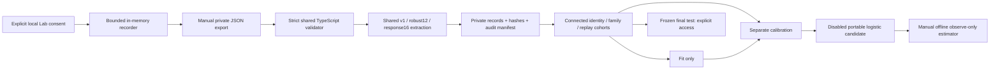

# Phase 5 architecture

Local engineering work on `feature/lavaguard-phase5`, October 18, 2026. Authentication remains the existing mandatory WebAuthn system. Phase 5 studies behavioral evidence; it does not prove humanity.

## Data flow

There is no raw-data upload, remote training, candidate promotion, or deployed Phase 5 selection route. `src/worker/guard/research-estimator.ts` is an unused integration seam. Detector, Policy, Enforcer, passkey handlers, secrets and production configuration remain unchanged.

## Schemas and provenance

`src/shared/research.ts` defines `lava-consent-v3` and `lava-study-record-v3`. Exports require exact fields, current consent revision before capture, explicit source and label provenance, ring-diameter normalization, capture settings, device, session and unique research attempt. These identifiers are separate from server nonces. Automation additionally requires family, revision, seed, independent run and trajectory lineage. Human declarations require a null generator. Unknown labels remain unlabeled. Consent and participant codes are declarations, not verified identities.

Labels, ring completion, server verdict and authentication are separate fields. Exports deliberately mark passkey options and authentication `not-tested`; the browser harness records those HTTP outcomes separately without storing credentials or clearances. Cancelled/expired/failed/accessible/short/unlabeled records are retained with exclusion reasons, never relabeled from CLEAR.

Strict validation rejects extra fields, nonfinite or nonmonotonic samples, wrong versions, conflicting labels, missing automation provenance and revoked identifiers. The importer stages a batch before writing; any invalid member prevents dataset writes. Canonical sorted JSONL, source hashes, retained private raw copies, byte hashes, extraction versions and exclusion audits provide reproducible lineage. Legacy v2 requires an explicit coordinator migration manifest; missing consent facts are never invented. Existing Phase 4 private data is not silently migrated.

## Features

The existing `lava-robust-v2` twelve-feature extractor is preserved. `lava-response-v3` adds sixteen experimental descriptors: reaction share, cadence CV, deceleration share, angular velocity, bursts, correction pauses, target coverage, tracking error mean/p95, response delay, target turns, pursuit, target switches, reacquisition, overshoot and late strategy change. A nearest observed moving bubble is a research proxy for a target, not evidence of participant intention.

Browser and importer use the same TypeScript implementations. Python consumes validated vectors rather than a second extractor. Pressure, WebDriver, acquisition source, device labels and study identifiers are not predictors. Cadence-sensitive features have explicit nuisance-control ablations. Point count, finite degenerate traces, timing, translation and joint pointer/target scaling have tests. Six-point counterfactual views are marked insufficient. Perturbations are derived views, not fresh participants or completed tasks.

## Splitting and models

Union-find connects human codes, bot families, sessions, capture runs, trajectory lineage and raw/canonical replay signatures, including excluded bridging records. A predeclared hash seed assigns connected groups approximately 60/20/20. Frozen hashed assignments preserve prior memberships as new groups arrive. A group merge across frozen cohorts, cross-cohort vector duplicate, or missing label in a partition stops fitting. The program does not reshuffle until a favorable split appears.

Fixed baselines are regularized logistic regression, random forest and histogram gradient boosting using existing scikit-learn dependencies. A human-only Isolation Forest is an outlier diagnostic. Deep sequence learning is deferred until independent application sequences justify it. Participant/family sample weights prevent retries from increasing a group's total weight. Training uses log1p features; logistic scaling is fitted on training only. Independent sigmoid calibration and a conservative empirical 1% human calibration flag target use calibration only. That target is not a demonstrated population false-positive rate.

Normal evaluation fits/calibrates without constructing a final-test feature matrix. `--evaluate-test` explicitly consumes the final evaluation and persists a lock; repetition requires `--acknowledge-test-reuse` and is exploratory. Development ablations, matched perturbations and leave-one-family-out experiments receive only primary fitting groups. Reused development humans make family folds correlated; do not pool them as independent trials.

## Outputs and inference

Private reports include confusion numerators/denominators, acceptance/FNR, ROC-AUC, PR-AUC, Brier, ten-bin ECE/reliability, attempt-level Wilson intervals, code/family summaries, device slices, OOD counts, package versions, seed, parameters, hashes, timing and Python memory/size diagnostics. Attempt intervals do not provide independent-person population coverage. Standalone reliability SVG/HTML has no external network access.

Only logistic coefficients have a strict portable JSON format. Python and TypeScript golden inference agrees within `1e-12` on synthetic inputs. Parsing rejects activation/executable/unknown/invalid fields. Off, missing/stale/withdrawn models, unknown versions, dataset hash mismatch, malformed features, numerical instability, unsupported devices and OOD inputs return an uncertain null score. Every valid result also remains high-uncertainty and `action: observe`; it cannot authorize CLEAR, FLAG, BLOCK or authentication.

Current evidence and executed checks: [results](LAVAGUARD_PHASE5_ML_RESULTS.md). Operational protocol: [collection](LAVAGUARD_PHASE5_DATA_COLLECTION.md). Known risks and withdrawal: [security](LAVAGUARD_PHASE5_SECURITY.md).
